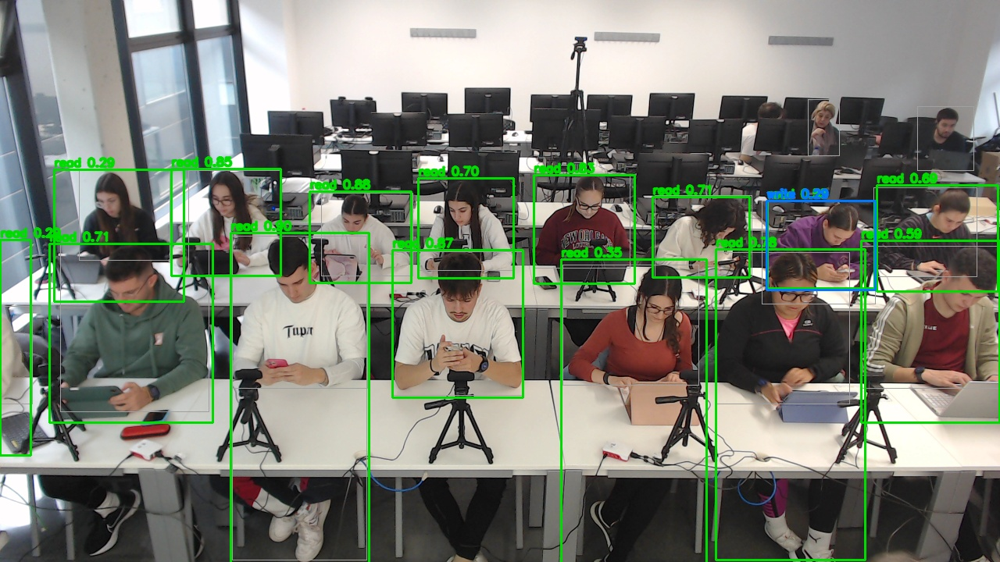
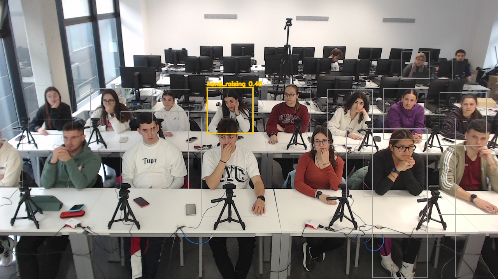
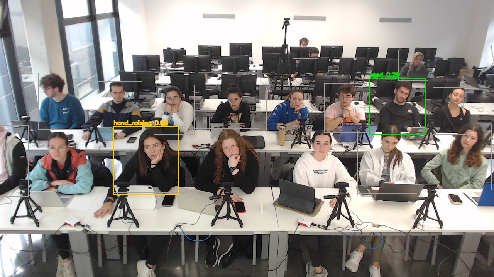

# SCB behaviour detection

This document records how the behaviour-detection feature family (design §5c, BFMU (c)) was
built: which pretrained model we could actually obtain, how it is loaded safely, how it behaves on
DIPSER, and why the pipeline passes its raw scores to the experts instead of using its class
decisions.

## 1. Goal

The design calls for a pretrained student-behaviour detector trained on SCB-Dataset3, with six
classes (hand-raising, reading, writing, using phone, bowing the head, leaning over the table),
whose per-frame detections are matched to tracks and summarised per window. It is the only
component meant to say *what a student is doing* rather than *how they move*. §5c and §11 require
a sanity check on DIPSER frames before its output is trusted.

## 2. Finding a usable checkpoint

The design names `wintonYF/SCB3-YOLOv7` on Hugging Face. That repository does not exist under
that name (the author has no model repositories), so the search covered every candidate:

| Source | What it is | Usable? |
|---|---|---|
| `data/SCB-Dataset3/` (already on disk) | a Roboflow re-export of an SCB-derived dataset, 13,090 images, classes `handrise, read, sleep, stand, using_electronic_devices, write` | dataset only, no weights; its classes differ from the design's SCB3 |
| `wintonYF/SCB-Dataset` on Hugging Face (`data/SCB-ST-Dataset4/YOLO.zip`) | the authors' training runs for YOLOv5, v8, v9, v10, v11, v12, v13 (mAP50 up to 0.94) | **no**: every run was trained on `SCB5_Teacher_Behavior_Stand_BlackBoard_Sreen`, a *teacher*-behaviour subset |
| Official SCB-Dataset3 and YOLOv7 student models ([Whiffe/SCB-dataset](https://github.com/Whiffe/SCB-dataset)) | the models the design meant | only on Baidu Netdisk, which needs a Baidu account and client; the README also says SCB3 is being remade because of data issues |
| Hobby repositories on GitHub (MIT, 0–1 stars) | YOLOv8 with `distracted, concentrating, hand_raised, phone, sleeping` | **no**: subjective engagement classes, no reading or writing, private training footage, no reported accuracy; untrusted pickles |
| **Extracted student checkpoints in `data/SCB-ST-Dataset4/`** | the authors' YOLOv7 runs on student-behaviour subsets, already downloaded with the dataset | **yes** |

The usable checkpoints, with the final validation numbers from each run's `results.txt`:

| Checkpoint (`data/SCB-ST-Dataset4/...`) | Classes | Precision | Recall | mAP50 | mAP50-95 |
|---|---|---|---|---|---|
| `SCB5-Handrise-Read-write-2024-9-17/exp/weights/best.pt` | hand-raising, read, write | 0.71 | 0.71 | **0.74** | 0.57 |
| `SCB5-Discuss-2024-9-17/exp/weights/best.pt` | discuss | 0.67 | 0.73 | 0.75 | 0.39 |
| `SCB_BowTurnHead_20250509/exp/exp/weights/best.pt` | BowHead, TurnHead | 0.23 | 0.43 | **0.22** | 0.08 |

The pipeline uses the **hand-raising / read / write** model. It covers three of the design's six
behaviours. Bowing the head exists but its model is weak (mAP50 0.22); phone use and leaning over
the table have no available model. Discussion is not one of the design's classes.

## 3. Loading YOLOv7 checkpoints safely

YOLOv7 checkpoints are Python pickles that store YOLOv7's own module classes, so two things are
needed: YOLOv7's model code, and a way to load a third-party pickle without letting it run code.

**Model code.** The official repository is cloned into `lib/yolov7` at commit `a207844` and used
only for its model definitions (`models/common.py`, `models/yolo.py`). Letterboxing and
non-maximum suppression are reimplemented in `src/bfmu/yolov7.py` with OpenCV and torchvision, so
YOLOv7's older utilities stay out of the inference path.

**Safe loading.** Loading a pickle normally (`torch.load(weights_only=False)`) can execute
arbitrary code embedded in the file; our first attempt to load the checkpoint that way was
blocked for exactly that reason. `load_yolov7` instead:

1. lists the classes the file references *without loading it*
   (`torch.serialization.get_unsafe_globals_in_checkpoint`). The SCB checkpoints reference 17:
   YOLOv7's layer classes, standard `torch.nn` layers, and numpy array reconstruction;
2. refuses to load if any reference falls outside an allowlist of those families;
3. loads with `weights_only=True` restricted to exactly those classes, plus numpy's numeric dtype
   classes (numpy 2 rebuilds stored dtypes as classes such as `Float64DType` that never appear by
   name in the file).

A unit test saves a checkpoint containing a disallowed type and checks that loading raises.

**Environment issues met on the way** (recorded in the contributor's guide, Chapter 10):

- importing torchvision before Pillow breaks Pillow's compiled module in this environment
  (`DLL load failed ... cannot run %1`); `src/bfmu/yolov7.py` imports Pillow first;
- YOLOv7's `utils/plots.py` imports `seaborn` at load time; it was installed with `--no-deps`.

The loaded model: YOLOv7, 37.2M parameters, classes `['hand-raising', 'read', 'write']`.

## 4. The DIPSER sanity check (§11)

`python -m scripts.dipser.check_scb` samples 12 frames across the in-scope sessions (seed 0), runs
the model at confidence 0.25, and writes annotated images and per-frame counts to
`outputs/scb_check/`. Person-detector boxes are drawn thin grey for reference.

Detections per frame ([counts.csv](../../outputs/scb_check/counts.csv)):

| Session | Frame | hand_raising | read | write |
|---|---|---|---|---|
| group_01 / experiment_01 / cam 01 | 578 | 0 | 9 | 0 |
| group_01 / experiment_01 / cam 02 | 1201 | 0 | 8 | 0 |
| group_01 / experiment_02 / cam 01 | 32 | 0 | 1 | 0 |
| group_01 / experiment_03 / cam 03 | 1070 | 1 | 0 | 0 |
| group_01 / experiment_04 / cam 03 | 971 | 0 | 15 | 1 |
| group_01 / experiment_05 / cam 02 | 44 | 0 | 7 | 0 |
| group_02 / experiment_02 / cam 01 | 1270 | 0 | 0 | 0 |
| group_02 / experiment_03 / cam 03 | 737 | 1 | 1 | 0 |
| group_02 / experiment_06 / cam 03 | 194 | 0 | 5 | 0 |
| group_03 / experiment_01 / cam 01 | 4 | 0 | 2 | 0 |
| group_03 / experiment_03 / cam 01 | 128 | 0 | 2 | 0 |
| group_03 / experiment_05 / cam 02 | 1123 | 0 | 7 | 0 |

### What the frames show

**`read` fires on anyone looking down at a desk or a device.** In the Canva design task (experiment
04), 15 of about 17 students are tagged `read`. They are looking at phones, tablets and laptops;
the boxes land on the right students, but the class cannot separate reading from device use,
because SCB has no device class.

**`hand_raising` fires on hand-to-face poses.** Both hand-raising detections in the sample are
students resting their head on a hand: one at confidence 0.48 during a lecture (experiment 03),
one at 0.29 in group 02. Nobody in the 12 frames actually raises a hand. In the second frame,
`read` (0.29) also fires on a student looking straight ahead.

**`write` is rare and mostly wrong**: one detection in 12 frames, on a student using a phone.

**Students facing forward get no detection**, which is correct: SCB has no "listening" or
"attending" class, so the absence of detections is itself the forward-attention state.

### Verdict

The detector localises students reliably but its classes do not transfer to DIPSER. Read as
labels, its output would mean: `read` ≈ head down at something, `hand_raising` ≈ hand near the
face, `write` ≈ rare noise. That is the design's domain-shift risk (§5c, §13) made concrete: the
detector was trained on classrooms with paper, raised hands and no laptops.

## 5. Response: pass the scores, not the decisions

Instead of trusting SCB's classes, the pipeline gives its raw scores to the engagement experts and
lets them learn, on DIPSER, what the scores mean. "Wrong but consistent" is then useful: if `read`
reliably fires on students looking down at a device, an expert can learn that mapping per
activity. Confusion is also information: a student scoring 0.4 on both read and write is
distinguishable from one scoring 0.8 on read alone.

`ScbBehaviour` in `src/bfmu/scb.py`, `mode: "soft"` (the default):

1. take **every candidate box** YOLOv7 produces, before thresholding and before NMS (which would
   delete the overlapping, confused candidates), dropping only empty anchors (objectness < 0.01);
2. assign each candidate to the single track it overlaps best (IoU), if at least half of it lies
   inside that track's box;
3. per track and frame: the highest `objectness × class probability` per class, and the highest
   objectness alone; 0 when no candidate landed on the student. YOLOv7's class probabilities are
   independent sigmoids rather than a softmax, so classes can co-fire;
4. per window: the **mean and the peak** of each score. The peak keeps brief events such as a
   hand going up for one second.

That gives 8 per-track features (`scb.hand_raising`, `scb.read`, `scb.write`, `scb.m0.obj`, each
with `.max`), summarised across students into Vec like every other BFMU family.

`mode: "flags"` keeps the original approach (thresholded, NMS'd detections Hungarian-matched to
tracks, a 0/1 flag per class) so the two can be compared.

### What soft scores look like on real frames

Frame pass on the first 40 frames of `group_01/experiment_04/context_cam_03` (the Canva frame
above), per track, mean / peak over the 40 frames:

| Track | read | write | hand_raising | objectness |
|---|---|---|---|---|
| 0 | 0.84 / 0.91 | 0.02 / 0.08 | 0.00 / 0.01 | 0.84 / 0.91 |
| 1 | 0.05 / 0.18 | 0.00 / 0.01 | 0.01 / 0.02 | 0.05 / 0.18 |
| 3 | 0.52 / 0.88 | 0.01 / 0.03 | 0.05 / **0.44** | 0.52 / 0.88 |
| 9 | 0.49 / 0.87 | **0.33 / 0.81** | 0.01 / 0.01 | 0.60 / 0.87 |

Where flags would have marked nearly everyone `read = 1`, soft scores grade students from 0.05 to
0.84; track 9 sits between read and write, and track 3's brief hand-raising blip survives only in
the peak. Objectness closely follows the strongest class here and may turn out redundant; the
experts' coefficients will show it.

## 6. Tools

- **`python -m scripts.dipser.check_scb`**: the §11 sample check above.
- **`python -m scripts.dipser.scb_viewer <group> <experiment> <camera>`**: plays a camera with SCB
  boxes drawn live, a confidence slider per class, a per-class timeline of detections, and person
  boxes on `p`. Frames are analysed once at a low confidence floor and cached, so sliders and
  scrubbing are instant. Used to pick per-class thresholds by eye.
- **Per-class thresholds** in config (`class_conf`, e.g. `{"hand_raising": 0.6}`) apply in flags
  mode; the viewer reads them as its starting slider positions.

## 7. Cost

About 100 ms per frame for SCB alone on the GTX 1080, measured while two tracker searches shared
the GPU (so an upper bound). It is the single most expensive per-frame stage, ahead of person
detection (~55 ms) and residual flow (~56 ms). A 37M-parameter detector on every frame is a
natural target in the performance phase.

## 8. Open

- **Does SCB earn its place?** To be settled by the feature-family ablation (all features vs
  without SCB vs motion only) under leave-one-group-out, once full features are extracted. If it
  adds nothing, that is a reportable finding in itself.
- **Soft vs flags**: two extractions (the mode changes the frame pass), compared on the same
  experts.
- **BowTurnHead**: not used because its validation mAP50 is 0.22. In soft mode it could be added
  and left to the experts to judge; head pose is relevant to attention.
- **Alternative**: a frozen pretrained image encoder (for example DINOv2-small or ResNet18) on
  student crops, with the same "learn the mapping on DIPSER" principle but without fixed
  classes. Proposed, not decided.
