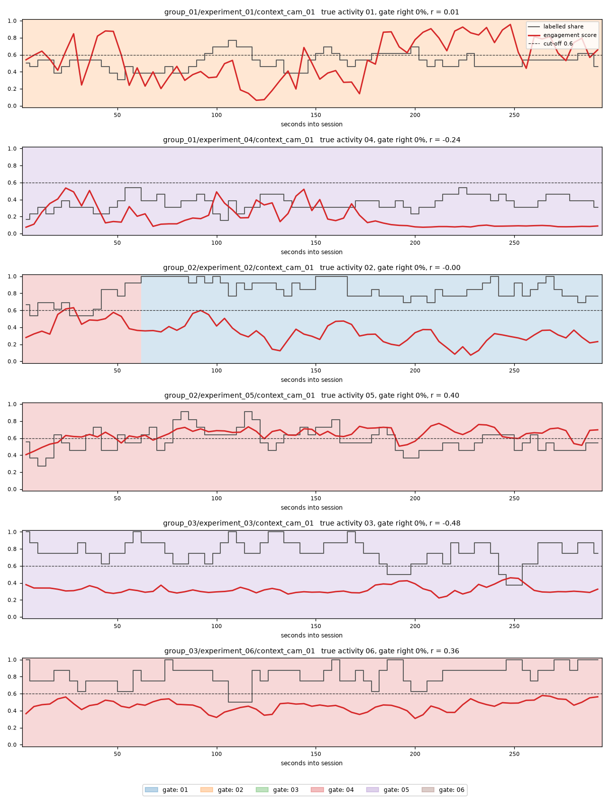

# The first full-length run: six sessions, end to end

*15 November 2026. Superseded at full scale by experiment 06; kept for what it first showed. The
metrics and evaluation terms are explained in guide Chapter 12. Appendices A and B hold the detailed
re-scoring and signal analysis that the guides cite.*

**Goal.** Run the whole pipeline (extraction, training, held-out evaluation, inference on an unseen
session) on full-length recordings for the first time, and answer two questions: **does every stage
work at full length, and at what cost? And do the features carry any signal about the attention
labels?**

**Setup.** Six full recordings, one per activity, camera 01, rotating through the groups
(`group_01/experiment_01`, `group_02/experiment_02`, `group_03/experiment_03`,
`group_01/experiment_04`, `group_02/experiment_05`, `group_03/experiment_06`); an unseen lecture
(`group_01/experiment_03/context_cam_01`) for inference. The config of that day:
- BoT-SORT with quick-tuned settings, residual flow, SCB in soft mode;
- late aggregation, logistic-regression experts, a random-forest gate predicting the activity;
- window labels thresholded at the provisional `tau_att = 3`, `tau_share = 0.6`;
- leave one group out: each fold trains on four sessions and is scored on the held-out group's two.

Results `24387875c765` (`outputs/experiments/04_six_session/`, with `run.log`); the commands are in
`scripts/analysis/e2e6/run.sh`, the analysis scripts next to it; working output in `tmp/e2e6/`.

## 1. Result

**The pipeline works at full length.** 438 windows from the six sessions (73 each), all but one
labelled; late aggregation built 4,929 student rows, 92% linked to a labelled student. Extraction of
the six took 28 minutes, training under a minute, inference on the unseen session 268 s. Per-stage
cost, mean ms per frame (range) over the six, measured under load, so upper bounds:

| Decode | Detection | Tracking | Residual flow | SCB | Scene | Total |
|---|---|---|---|---|---|---|
| 48.7 (24–63) | 28.7 (25–33) | 2.2 | 56.0 (52–61) | 47.3 (38–62) | 1.9 | **185** (143–211) |

About real time for a 5 fps camera: a 45-minute session takes about 40 minutes, against the
design's 3-minute target.

**The engagement scores are at chance.** Window level, per held-out fold:

| Variant | AUC | F1 | Balanced accuracy |
|---|---|---|---|
| `majority` | 0.50 | 0.35 ± 0.35 | 0.50 |
| `configured` (per-activity experts) / classified | 0.44 ± 0.20 | 0.22 ± 0.16 | 0.47 ± 0.12 |
| `shared_expert` / classified | 0.51 ± 0.14 | 0.48 ± 0.37 | 0.53 ± 0.03 |
| `hand_weighted` / classified | 0.53 ± 0.20 | 0.09 ± 0.10 | 0.51 ± 0.01 |
| Gate accuracy (6-way) | | | **0.00** |

The results file also has *oracle* rows (the true activity instead of the gate's prediction). Here
they are constants (AUC 0.50), because the held-out activity's expert never saw a training row (§2);
guide 13 §13.16 traces how every row came about. A within-session correlation, `retention_r`, was
also reported; the metric was removed on 16 November 2026 (`docs/misc/proposed_metrics.md`).

*Per session: engagement score (red) from models that never saw that group, labelled share of
engaged students (grey), cut-off 0.6 (dashed); background = the gate's predicted activity.*

On the unseen lecture, the models trained on all six sessions gave scores of 0.37–0.72, and the
gate called **every window** activity 04 (the truth is 03).

## 2. Why these scores say little about the models

- **Each activity appears in only one group.** Holding out a group holds out two activities
  completely: the gate is asked for activities it never saw (0% by construction), and the
  per-activity experts have no data for them. Only `shared_expert` and `hand_weighted` are
  meaningful, and both are at chance.
- **The base rate differs sharply by activity** (windows labelled engaged: 01: 25%, 02: 95%,
  03: 92%, 04: 0%, 05: 44%, 06: 96%), so folds differ in balance (12%, 69%, 94% engaged) and fold
  means are unstable.
- **The gate failed even with its classes in training.** With one recording per activity, scene
  features describe one room on one day per class; the gate cannot separate activity from room.
- **The labels are the open risk**: provisional thresholds on labels with near-zero agreement
  between labelers (experiment 01).

## 3. Where the signal is (Appendix B)

Chance-level averages could mean no information in the features, or a model and target that fail
to use it. The cached features tell these apart; with six sessions, these are leads, not results.
- **The target is mostly a per-session level.** 69% of the variance of the labelled share lies
  between sessions; within a session it moves by about ±0.1, and the thresholded window label
  changes 0–18 times in 73 windows. Pooled across leave-one-group-out folds, AUC mostly rewards
  guessing each group's level: the shared expert's pooled AUC is 0.85 against 0.51 per fold
  (Appendix A). Pooled numbers across such folds should not be reported.
- **The features carry consistent signal.** Within sessions, class residual flow correlates with the
  labelled share at ρ −0.29 to −0.34, speed −0.22, stillness +0.20, with the same sign in every
  session: when the class moves more, fewer students are rated attentive. At student level, SCB
  `read` and `write` go with *lower* attention (consistent with `read` firing on device use).
- **The models use that signal worse than one feature does.** Minus the class's residual flow, with
  no model at all, traces the labelled curve better than any trained model; dropping the class
  context from the student rows raised the shared expert's AUC from 0.51 to 0.57. The models mostly
  learn between-session differences that do not transfer.
- **The hand-weighted baseline's SCB signs are backwards on DIPSER** (it weights `read` and `write`
  positively).

## 4. Conclusion, and what it led to

Every stage runs at full length, at about real time; the engagement scores are at chance, but in a
design that cannot test the models fairly (one session per activity), and the features do carry a
consistent, if weak, within-session signal that the models fail to use. What followed:
- **Train and score each labeler's own entries** instead of a thresholded window share (experiment
  05, then 06), which keeps the rating's movement instead of a near-constant label.
- **Run at full scale** (52 recordings, every activity in every group; experiment 06), and **measure
  the labels themselves** (06 Part 1).
- **Report baselines and per-fold numbers, never pooled across groups** (06 onward).
- **Drop the class context** from the student rows: confirmed at full scale in experiment 08 and the
  default in experiment 09.
- **The gate**: the mixture of experts tied with a single decoder at full scale (06) and is delayed
  (experiments README).

## Appendix A: the same predictions, scored with the benchmarks' metrics

The table in §1 is what `train_models` reports: binary metrics per held-out fold, averaged over
the three folds. The published DIPSER works (`docs/misc/benchmarks.md`) use other metrics and
other ways of computing them, so the run's held-out predictions were re-scored with those
(`scripts/analysis/e2e6/benchmark_metrics.py`; it replays the leave-one-group-out loop and reproduces the stored
per-fold AUCs exactly: 0.604, 0.614, 0.311 for the shared expert). Variants:

- **train mean**: predicts the training folds' mean labelled share for every window; the trivial
  baseline.
- **shared expert**: one logistic-regression expert for all activities, late aggregation, Vec as
  context (the default).
- **shared expert, no context**: the same with `engagement.late_context=false`.
- **hand weighted**: the configured hand-weighted experts.
- **minus flow**: no model, the negative mean residual flow of the class, used directly as the score
  (threshold: its median). Window level only.

Terms as in `benchmarks.md` §2: *per window* counts every window; *per change* gives each run of an
unchanged label weight 1 in total, whatever its length; *pooled* scores all held-out predictions of
all folds together; *per session* scores each session and averages over the six (sessions with
one class have no AUC or balanced accuracy and are skipped for those).

**Window level, thresholded label** (engaged when the labelled share ≥ 0.6), per window, averaged
per session:

| Variant | AUC | Accuracy | Balanced acc. | Macro F1 | F1 not engaged | Weighted F1 |
|---|---|---|---|---|---|---|
| train mean | 0.50 | 0.29 | 0.50 | 0.18 | 0.04 | 0.22 |
| shared expert | 0.56 | **0.75** | 0.55 | **0.46** | 0.45 | **0.74** |
| shared expert, no context | **0.64** | 0.46 | 0.50 | 0.29 | **0.48** | 0.43 |
| hand weighted | 0.55 | 0.19 | 0.50 | 0.14 | 0.21 | 0.13 |
| minus flow | 0.63 | 0.54 | 0.52 | 0.39 | 0.32 | 0.56 |

**Window level, the labelled share as a continuous target** (MAE and RMSE only for scores that
estimate the share; *r within session* is `retention_r`):

| Variant | MAE | RMSE | Pearson r, pooled | Pearson r, within session |
|---|---|---|---|---|
| train mean | 0.238 | 0.270 | −0.72 | 0 |
| shared expert | **0.155** | **0.205** | **0.62** | 0.07 |
| shared expert, no context | 0.203 | 0.244 | 0.32 | 0.24 |
| hand weighted | – | – | −0.64 | 0.12 |
| minus flow | – | – | 0.05 | **0.30** |

**Student level, each linked student's own label** (4,537 labelled student-windows, 64% engaged;
threshold 0.5), per window, pooled, the way §3.4 of `benchmarks.md` scores its windows:

| Variant | AUC | Accuracy | Balanced acc. | Macro F1 | F1 not engaged | Weighted F1 |
|---|---|---|---|---|---|---|
| train mean (always "engaged") | 0.34 | **0.64** | 0.50 | 0.39 | 0 | 0.50 |
| shared expert | **0.61** | 0.59 | **0.58** | **0.57** | **0.50** | **0.60** |
| shared expert, no context | 0.54 | 0.55 | 0.54 | 0.53 | 0.44 | 0.56 |
| hand weighted | 0.36 | 0.40 | 0.41 | 0.40 | 0.34 | 0.41 |

**The same shared-expert predictions, computed six ways:**

| Level | Metric | Per fold (as in §1) | Per window, pooled | Per window, per session | Per change, pooled | Per change, per session |
|---|---|---|---|---|---|---|
| Window | AUC | 0.51 | **0.85** | 0.56 | 0.51 | 0.44 |
| Window | Macro F1 | – | 0.75 | 0.46 | 0.50 | 0.40 |
| Window | F1 not engaged | – | 0.75 | 0.45 | 0.61 | 0.47 |
| Student | AUC | – | 0.61 | 0.54 | 0.53 | 0.54 |
| Student | Macro F1 | – | 0.57 | 0.46 | 0.52 | 0.44 |

What this adds to §1 and §2:

- **Pooling across folds rewards getting each group's level right.** The shared expert's mean
  score per held-out group (0.35, 0.53, 0.88) ranks the groups' engaged rates (12%, 69%, 94%)
  correctly, so pooled over all held-out windows its AUC is 0.85 and its correlation with the share
  0.62, while within each fold and each session it is near chance. With three groups that is
  three points in the right order, not evidence of a working model. The same choice makes the
  train-mean baseline look *worse* than chance (pooled AUC 0.13, r −0.72): holding out a group with
  many engaged windows lowers the training mean, so the constant is anti-correlated with the held-out
  level by construction. Pooled numbers across leave-one-group-out folds should not be reported.
- **On the continuous share the shared expert beats the trivial baseline**: MAE 0.155 against
  0.238 (35% lower), RMSE 0.205 against 0.270. Almost all of it is the per-group level again; the
  within-session correlation is 0.07. Removing the context or using residual flow alone gives the
  better within-session shape (0.24, 0.30), as Appendix B.4 found.
- **Against the published floors, at student level:** the shared expert's not-engaged F1 (0.50) is
  *below* the constant "always not engaged" on these labels (0.53 for a 36% minority;
  `benchmarks.md` §1 explains why a minority-class F1 rewards that constant). Its AUC of 0.61 is
  above chance; the informal desk-camera project reaches 0.79 on a filtered target with face
  close-ups. Accuracy (0.59) is below "always engaged" (0.64). By the metrics a constant cannot
  game, AUC and balanced accuracy, the student-level model is slightly above chance.
- **Per change versus per window** changes the picture as much as the model choice: for the shared
  expert, the student-level AUC falls from 0.61 to 0.53 and the window-level F1 for "not engaged"
  rises from 0.45 to 0.61 (per session to pooled per change), because short dips weigh as much as
  long stretches.
- **The hand-weighted experts are worse than chance** wherever levels or students are compared
  (window r pooled −0.64, student AUC 0.36), which confirms Appendix B.4: its SCB signs are backwards on
  DIPSER.

## Appendix B: where the signal is

Chance-level averages could mean the features carry no information, or that the models and the
target fail to use it. The cached features and labels of this run allow telling these apart.
Script: `scripts/analysis/e2e6/analyse.py`. Six sessions are few, so everything below is a lead to test on the
full extraction, not a result.

### B.1 The target is mostly a per-session level

| Session | Mean labelled share | Within-session SD | Windows labelled engaged | Label changes (of 73 windows) |
|---|---|---|---|---|
| g01 / exp 01 | 0.52 | 0.10 | 25% | 10 |
| g01 / exp 04 | 0.36 | 0.09 | 0% | 0 |
| g02 / exp 02 | 0.83 | 0.13 | 95% | 4 |
| g02 / exp 05 | 0.58 | 0.13 | 44% | 18 |
| g03 / exp 03 | 0.77 | 0.14 | 92% | 4 |
| g03 / exp 06 | 0.82 | 0.13 | 96% | 3 |

**69% of the variance of the labelled share lies between sessions**; within a session it moves by
about ±0.1. Thresholded at `tau_share = 0.6`, the window label is close to constant in most
sessions (0 to 18 changes in 73 windows). Pooled AUC on held-out windows therefore mostly asks
whether the model knows each session's level, which depends on group and activity, exactly what
leave-one-group-out holds out. The question a retention graph answers, whether the curve rises and
falls with the class, is measured by `retention_r`, not by pooled AUC.

### B.2 Student labels: both who and when

64 linked students, 4,537 labelled student-windows, 64% engaged. 16% of students keep the same label
for the whole session. Of the variance in student labels, 44% is between students (some are
generally rated attentive) and 56% within students over time. Per-student labels do vary in time,
though with labeler agreement near zero some of that variation is labeler noise.

### B.3 The features do carry consistent signal

**Window level, within sessions.** Spearman correlation of each class-mean feature with the
labelled share, computed inside each session and averaged:

| Feature | ρ (mean over sessions) | SD over sessions |
|---|---|---|
| residual flow, 4 cells (`rf.mag_ij.mean`) | −0.29 to −0.34 | 0.16–0.18 |
| speed, energy (`kg.speed.mean`, `kg.energy.mean`) | −0.22 | 0.17–0.19 |
| stillness (`kg.stillness.mean`) | +0.20 | 0.10 |
| velocity reversals (`kg.events.mean`) | +0.17 | 0.11 |

The signs are consistent across sessions and plausible: when the class moves more (articulated
motion, not just shifting), fewer students are rated attentive.

**Student level, single-feature AUC for a student's own label** (AUC below 0.5 means higher values
go with *not* engaged):

| Feature | Pooled | Within session | Between students (ρ) |
|---|---|---|---|
| SCB write (mean / peak) | 0.36 / 0.37 | 0.43 / 0.42 | −0.28 / −0.30 |
| SCB read (mean / peak) | 0.39 / 0.39 | 0.48 / 0.48 | −0.21 / −0.23 |
| SCB objectness | 0.40 | 0.49 | −0.18 |
| residual flow cells | 0.44–0.45 | 0.41–0.45 | −0.04 to −0.11 |
| velocity reversals | 0.57 | 0.57 | +0.15 |
| stillness | 0.50 | 0.50 | −0.15 |

SCB scores separate students (which students are rated less attentive) more than moments:
students on whom `read` and `write` fire are rated *less* engaged, consistent with `read`
firing on device use (guide Chapter 5, SCB). Residual flow works within sessions.

### B.4 The models use the signal worse than one feature does

Same features and labels, three expert variants, plus single features used directly as the curve:

| | AUC (shared expert) | `retention_r` (shared expert) |
|---|---|---|
| Late, with Vec as context (the default) | 0.51 | 0.06 |
| **Late, no context** (`late_context=false`) | **0.57** | **0.24** |
| Early (Vec only) | 0.45 | 0.05 |
| **Minus class residual flow, no model** | — | **0.32** (per session 0.33, 0.34, 0.41, 0.66, −0.02, 0.19) |
| Class stillness, no model | — | 0.19 |

Three readings:

- **Adding the classroom context hurts.** With Vec appended, the model can learn session-level
  offsets (room, activity, group) that fit the training groups and do not transfer; without it,
  it has to use each student's own behaviour.
- **One feature with the right sign beats every learned model** on the curve's shape. The models
  are learning the wrong thing, mostly between-session differences, not that the signal is absent.
- **The hand-weighted baseline has SCB signs that the data contradicts**: it weights `read` and
  `write` positively; on DIPSER both go with lower attention.
