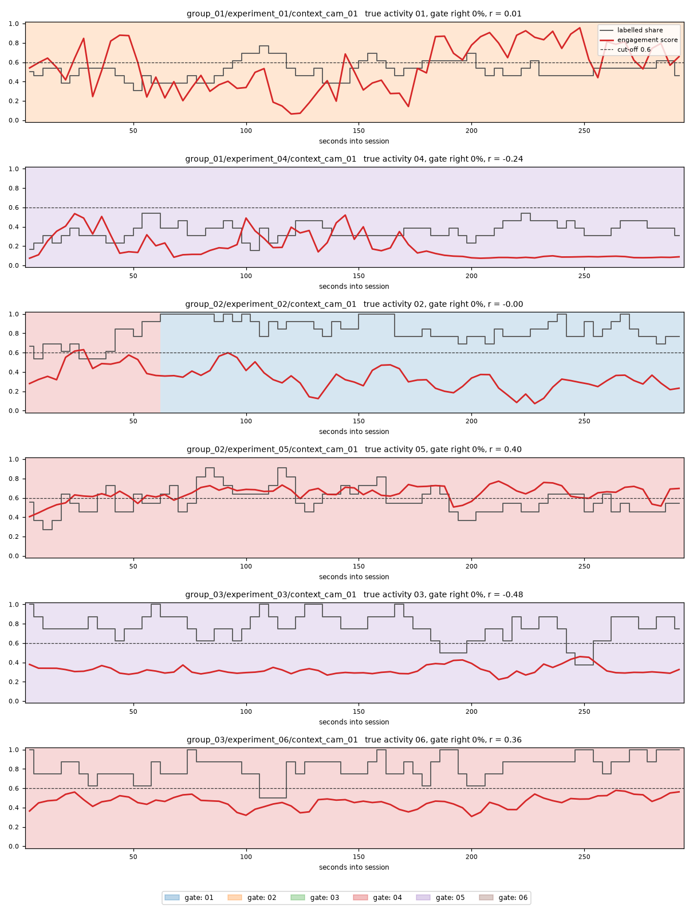
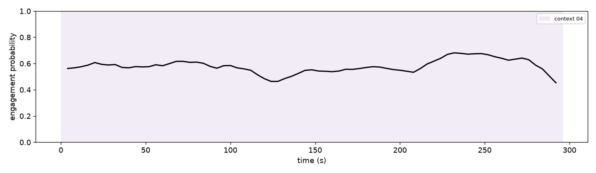

# The first full-length run: six sessions, end to end

On 15 November 2026 the whole pipeline ran for the first time on full-length recordings:
extraction, training, held-out evaluation and inference on an unseen session. This document
records the setup, what worked, what the numbers do and do not show, and what follows from it.

**In short:** every stage works at full length, and per-stage costs are now measured on real
sessions. The engagement results are at chance level, and this sample is too small, in a specific
way (§4), to judge model quality. But the features do carry consistent signal (§6): class motion
falls when more students are rated attentive, and that one feature traces the labelled curve
better than any trained model. The models mostly learn between-session differences that do not
transfer. §7 lists what to change.

## 1. Setup

| | |
|---|---|
| Sessions | six full recordings, one per activity, camera 01, rotating through the groups: `group_01/experiment_01`, `group_02/experiment_02`, `group_03/experiment_03`, `group_01/experiment_04`, `group_02/experiment_05`, `group_03/experiment_06` |
| Unseen session for inference | `group_01/experiment_03/context_cam_01` (a lecture) |
| Config | `configs/deliverable3.json` as of that day: BoT-SORT with the quick-tuned settings, residual flow, SCB soft mode, **late aggregation**, logistic-regression experts, random-forest gate |
| Label thresholds | provisional `tau_att=3`, `tau_share=0.6` (the design's 4 / 0.5 give almost no engaged windows; `01_dipser.md`) |
| Output | `tmp/e2e6/` (not shared); script `tmp/e2e6/run.sh`, log `tmp/e2e6/run.log` |
| Config hash of the results | `24387875c765` (after `det_thresh` was dropped; the extraction ran under the previous hash, which differs only by that no-op key) |

Commands, per session, then once:

```
python -m scripts.run_pipeline extract --reuse --session <group>/<experiment>/context_cam_01 \
    --set output_dir="tmp/e2e6" labels.tau_att=3 labels.tau_share=0.6
python -m scripts.train_models --set output_dir="tmp/e2e6" labels.tau_att=3 labels.tau_share=0.6
python -m scripts.plot_results --set output_dir="tmp/e2e6" labels.tau_att=3 labels.tau_share=0.6
python -m scripts.run_pipeline infer --zip data/DIPSER/DIPSEER/group_01/experiment_03/context_cam_01.zip \
    --models tmp/e2e6/models/<hash>.joblib --out tmp/e2e6/infer_g1e3 --set ...
```

## 2. The pipeline at full length

| Session | Frames | fps | Camera gaps | Tracklets kept (raw) | Windows | Frame pass |
|---|---|---|---|---|---|---|
| group_01/experiment_01 | 1,468 | 5.00 | 12 | 15 (14) | 73 | 270 s |
| group_01/experiment_04 | 1,466 | 5.00 | 17 | 30 (28) | 73 | 296 s |
| group_02/experiment_02 | 1,482 | 5.00 | 9 | 27 (28) | 73 | 308 s |
| group_02/experiment_05 | 1,477 | 5.00 | 12 | 24 (26) | 73 | 312 s |
| group_03/experiment_03 | 1,443 | 5.01 | 19 | 10 (15) | 73 | 207 s |
| group_03/experiment_06 | 1,424 | 5.16 | 19 | 8 (11) | 73 | 233 s |

"Kept" can exceed "raw" because the tracklet filter splits a track at a long gap into pieces.
Extraction of the six took 28 minutes, training under a minute, inference on the unseen session
268 s (its own fresh frame pass).

**Per-stage cost**, mean over the six sessions in ms per frame (range), measured while two tracker
searches shared the machine, so upper bounds:

| Decode | Detection | Tracking | Residual flow | SCB | Scene | Total |
|---|---|---|---|---|---|---|
| 48.7 (24–63) | 28.7 (25–33) | 2.2 | 56.0 (52–61) | 47.3 (38–62) | 1.9 | **185** (143–211) |

At about 185 ms per frame, a 5-fps camera is processed at roughly real time: a 45-minute session
would take about 40 minutes, against the design's 3-minute target.

**Data for the experts.** 438 windows, all but one with a window label (99.8%). Late aggregation
built 4,929 student rows (about 11 per window), of which 92% were linked to a labelled student.

## 3. Results (leave-one-group-out, window level)

Each fold trains on four sessions and is scored on the held-out group's two.

| Variant | AUC | `retention_r` | F1 | Balanced accuracy |
|---|---|---|---|---|
| `majority` | 0.50 | — | 0.35 ± 0.35 | 0.50 |
| `configured` / classified | 0.44 ± 0.20 | 0.01 ± 0.14 | 0.22 ± 0.16 | 0.47 ± 0.12 |
| `shared_expert` / classified | 0.51 ± 0.14 | 0.07 ± 0.15 | 0.48 ± 0.37 | 0.53 ± 0.03 |
| `hand_weighted` / classified | 0.53 ± 0.20 | 0.12 ± 0.04 | 0.09 ± 0.10 | 0.51 ± 0.01 |
| Gate accuracy (6-way) | | | | **0.00** |

The oracle rows and the gate are not interpretable here (§4). Results file:
`tmp/e2e6/results/24387875c765….json`.



*Per session: engagement score (red) from models that never saw that group, labelled share of
engaged students (grey), cut-off 0.6 (dashed); background = the gate's predicted activity.*

**Inference on the unseen lecture** (`group_01/experiment_03`, models trained on all six sessions):
73 windows, about 13 visible students per window, engagement score 0.37–0.72 (mean 0.58), 26
windows above the cut-off. The gate predicted activity 04 for **all 73 windows**; the true activity
is 03.



## 4. Why these numbers say little about the models

**Each activity appears in only one group.** With one session per activity, holding out a group
holds out two activities completely: the gate is asked to predict activities it has never seen, so
it scores 0% by construction, and in the oracle condition the held-out activity's expert has no
training data at all. The configured mixture (per-activity experts) is therefore tested only on
activities without an expert. Only `shared_expert` and `hand_weighted` are meaningful in this
design, and both are at chance.

**The base rate differs sharply by activity.** Share of windows labelled engaged: 01: 25%,
02: 95%, 03: 92%, 04: 0%, 05: 44%, 06: 96%. Folds therefore differ in class balance (12%, 69% and
94% engaged in the held-out groups), which by itself moves F1 and makes fold means unstable. In
the plots the labelled share is mostly a per-session level with small changes, so much of what
there is to predict is which activity it is rather than moment-to-moment change.

**The gate failed even with its classes in training.** On the unseen lecture the final gate had
seen activity 03 (from group 03) and still called every window 04. With one recording per activity,
the scene features describe one room on one day per class; the gate cannot separate activity from
room. The full extraction gives each activity three groups and three cameras.

**The labels remain the open risk.** These runs use provisional thresholds on labels with near-zero
inter-labeler agreement (`01_dipser.md`; contributor's guide, Chapter 11).

## 5. What it established

- Extraction, training, evaluation, plotting and inference all run on full-length data with the
  default configuration, including late aggregation with association-based per-student labels
  (92% linked).
- Per-stage cost at full length: residual flow (56 ms) and SCB (47 ms) dominate after decoding;
  tracking is negligible without ReID.
- The tools to inspect a run exist and work on it: `plot_results` (held-out curves) and
  `output_viewer` (a session with per-student scores and labels).

## 6. Analysis: where the signal is

Chance-level averages could mean the features carry no information, or that the models and the
target fail to use it. The cached features and labels of this run allow telling these apart.
Script: `tmp/e2e6/analyse.py`. Six sessions are few, so everything below is a lead to test on the
full extraction, not a result.

### 6.1 The target is mostly a per-session level

| Session | Mean labelled share | Within-session SD | Windows labelled engaged | Label changes (of 73 windows) |
|---|---|---|---|---|
| g01 / exp 01 | 0.52 | 0.10 | 25% | 10 |
| g01 / exp 04 | 0.36 | 0.09 | 0% | 0 |
| g02 / exp 02 | 0.83 | 0.13 | 95% | 4 |
| g02 / exp 05 | 0.58 | 0.13 | 44% | 18 |
| g03 / exp 03 | 0.77 | 0.14 | 92% | 4 |
| g03 / exp 06 | 0.82 | 0.13 | 96% | 3 |

**69% of the variance of the labelled share lies between sessions**; within a session it moves by
about ±0.1. Thresholded at `tau_share = 0.6`, the window label is close to constant in most
sessions (0 to 18 changes in 73 windows). Pooled AUC on held-out windows therefore mostly asks
whether the model knows each session's level, which depends on group and activity, exactly what
leave-one-group-out holds out. The question a retention graph answers, whether the curve rises and
falls with the class, is measured by `retention_r`, not by pooled AUC.

### 6.2 Student labels: both who and when

64 linked students, 4,537 labelled student-windows, 64% engaged. 16% of students keep the same label
for the whole session. Of the variance in student labels, 44% is between students (some are
generally rated attentive) and 56% within students over time. Per-student labels do vary in time,
though with labeler agreement near zero some of that variation is labeler noise.

### 6.3 The features do carry consistent signal

**Window level, within sessions.** Spearman correlation of each class-mean feature with the
labelled share, computed inside each session and averaged:

| Feature | ρ (mean over sessions) | SD over sessions |
|---|---|---|
| residual flow, 4 cells (`rf.mag_ij.mean`) | −0.29 to −0.34 | 0.16–0.18 |
| speed, energy (`kg.speed.mean`, `kg.energy.mean`) | −0.22 | 0.17–0.19 |
| stillness (`kg.stillness.mean`) | +0.20 | 0.10 |
| velocity reversals (`kg.events.mean`) | +0.17 | 0.11 |

The signs are consistent across sessions and plausible: when the class moves more (articulated
motion, not just shifting), fewer students are rated attentive.

**Student level, single-feature AUC for a student's own label** (AUC below 0.5 means higher values
go with *not* engaged):

| Feature | Pooled | Within session | Between students (ρ) |
|---|---|---|---|
| SCB write (mean / peak) | 0.36 / 0.37 | 0.43 / 0.42 | −0.28 / −0.30 |
| SCB read (mean / peak) | 0.39 / 0.39 | 0.48 / 0.48 | −0.21 / −0.23 |
| SCB objectness | 0.40 | 0.49 | −0.18 |
| residual flow cells | 0.44–0.45 | 0.41–0.45 | −0.04 to −0.11 |
| velocity reversals | 0.57 | 0.57 | +0.15 |
| stillness | 0.50 | 0.50 | −0.15 |

SCB scores separate students (which students are rated less attentive) more than moments:
students on whom `read` and `write` fire are rated *less* engaged, consistent with `read`
firing on device use (`03_scb.md`). Residual flow works within sessions.

### 6.4 The models use the signal worse than one feature does

Same features and labels, three expert variants, plus single features used directly as the curve:

| | AUC (shared expert) | `retention_r` (shared expert) |
|---|---|---|
| Late, with Vec as context (the default) | 0.51 | 0.06 |
| **Late, no context** (`late_context=false`) | **0.57** | **0.24** |
| Early (Vec only) | 0.45 | 0.05 |
| **Minus class residual flow, no model** | — | **0.32** (per session 0.33, 0.34, 0.41, 0.66, −0.02, 0.19) |
| Class stillness, no model | — | 0.19 |

Three readings:

- **Adding the classroom context hurts.** With Vec appended, the model can learn session-level
  offsets (room, activity, group) that fit the training groups and do not transfer; without it,
  it has to use each student's own behaviour.
- **One feature with the right sign beats every learned model** on the curve's shape. The models
  are learning the wrong thing, mostly between-session differences, not that the signal is absent.
- **The hand-weighted baseline has SCB signs that the data contradicts**: it weights `read` and
  `write` positively; on DIPSER both go with lower attention.

## 7. Directions for improving the scores

In rough order of expected effect per unit of work. Each is a config change or a small change,
testable on the full extraction (or already on these six sessions).

1. **Evaluate what the graph is for.** Make `retention_r` (within-session shape) a headline metric
   next to AUC, and add a within-session AUC. Pooled AUC on held-out groups mostly rewards guessing
   each session's level, which this setup can hardly learn and the retention graph does not need.
2. **Remove session-level offsets from the features.** The pipeline is offline and sees a whole
   session, so each feature can be expressed relative to that session (z-scored per session, or
   relative to the session median) before the experts see it. The within-session signal in §6.3
   survives this; the room, camera and activity offsets that do not transfer are removed. The
   gain of `late_context=false` points the same way.
3. **Predict a continuous target instead of a thresholded one.** The thresholded window label is
   nearly constant per session and throws away the ±0.1 movement the features follow. Candidates:
   regress the labelled share directly (window level), or each student's consensus attention
   (student level), and draw the curve from the prediction.
4. **Normalise labels per labeler.** Labelers use the scale differently (one sits at 3 most of the
   time, another at 2; Chapter 11 of the guide). Expressing each labeler's ratings relative to
   their own session baseline before taking the median turns "who rates high" into "when ratings
   change", which is what the features can see.
5. **Fewer, signed features before more models.** Residual flow, speed, stillness and velocity
   reversals are consistent across sessions; a small, strongly regularised model on them (or the
   hand-weighted baseline with data-backed signs: flow negative, stillness positive, SCB read and
   write negative) is a stronger baseline than the current one. Revisit `hand_weighted.weights`
   together with action item 2 of the guide's §11.6.
6. **Pool the experts.** Per-activity experts will see at most 6 session-cameras each under
   leave-one-group-out. A shared expert with the activity (or the gate's probabilities) as extra
   input shares data across activities while still letting device use mean different things.
7. **Smooth in time.** Labels change slowly (step functions held for tens of seconds), window
   features are noisy, and windows overlap. Averaging features or scores over neighbouring windows
   should raise `retention_r` at little risk.
8. **The gate needs more than one recording per activity.** Scene features describe one room on
   one day per class here; the full extraction gives three groups and three cameras per activity.
   If it still fails across rooms: feed it student behaviour (`gate_uses_vec`; device use differs by
   activity), and normalise per camera position (`cameras.yml`, `01_dipser.md` §4).
9. **People who are not students.** At inference teachers and TAs are averaged in like students.
   Tracks that move across the room or never sit in one place could be excluded by a simple
   position or stillness rule, which needs no identity.

Prerequisites, unchanged: the full extraction once the tracker is chosen (`02_boxmot.md`, §7), and
a decision on the label target (Chapter 11 of the guide).
