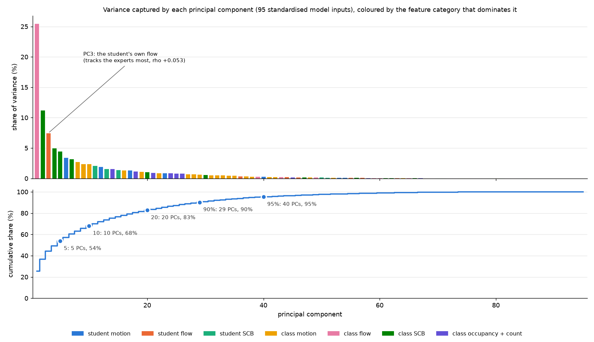
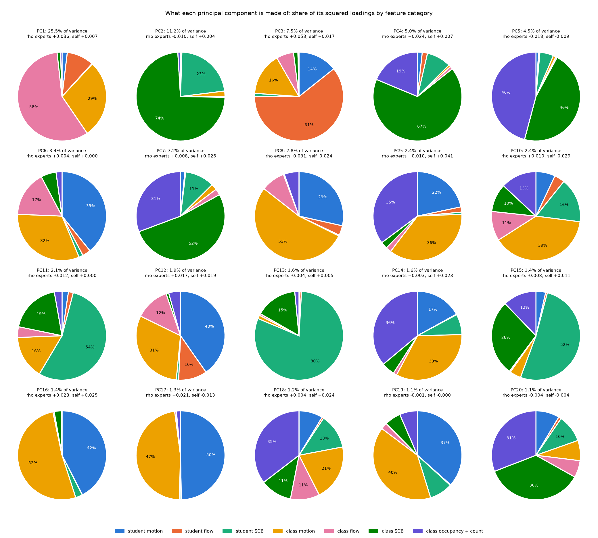

# PCA and dimensionality reduction

*Started 18 November 2026. §1 is the feature vector as experiment 06 trained on it; §2 designs the
dimensionality reduction; §3–§6 run it with logistic regression, the random forest and k-NN (k = 500
and k = 5). Base
config: [`08_pca.json`](08_pca.json), which is
experiment 06's config ([`06_full_pipeline_and_labels.json`](06_full_pipeline_and_labels.json))
with the entered rating as the training target (no interpolation) and the new `expert.pca` key off.*

**Why this experiment.** Experiment 06 ended with a model that underfits with every classical
decoder (training AUC 0.55–0.59). The decoder, the training target, the window length and
augmentation were all varied there, and none moved the result. What is left is the input.

---

## 1. The vector

Script: `python -m scripts.analysis.feature_study` (`scripts/analysis/feature_study.py`). Output in
`outputs/experiments/08_pca/`: `vector_stats.csv` (per-column distributions, redundancy,
variance shares), `correlations.csv`, `components.csv`, `feature_correlations.png`, `deciles.png`.
Rows: the 45,166 rows experiment 06 trains on, original recordings only.

### 1.1 Layout

Each row is one student in a 4 s window centred on a rating entry. The per-labeler model (an
expert) receives 95 numbers; the activity gate, a separate model, receives 26 more.

| Block | Columns | Family | What each column is | Source |
|---|---|---|---|---|
| `trk.*`: the student | 10 | motion (Kalman) | box-centre velocity, speed, acceleration, energy, share of still frames, sign flips per second, trends of area, aspect and height; divided by the box diagonal | the tracker's Kalman state, about 5 fps |
| | 9 | flow (residual) | optical-flow magnitude in a 3 × 3 grid inside the box, with the box's own mean flow removed; window mean | Farneback flow on the frame at half resolution (640 × 360) |
| | 8 | behaviour (SCB) | hand raising, reading, writing, and objectness scores from the SCB YOLOv7 detectors, mean and peak over the window | detector at 640 px |
| `vec.*`: the class | 54 | the same 27 | mean and SD across the visible students | from the `trk.*` values |
| | 4 | thresholds | share of students still, hand up, reading, writing | |
| | 9 | occupancy | share of students in each cell of a 3 × 3 grid over the frame | box centres |
| | 1 | count | `n_tracks`, the number of visible students | |
| **Model input** | **95** | | | |
| `scene.*`: the gate | 26 | scene | whole-frame motion, saturation, brightness, edges, a 3 × 3 brightness grid; mean and SD over the window | frame at 64 × 36 |

**The features themselves look fine for what these labels allow.** Every column's correlation with
every labeler is in Appendix A. The strongest per-student signal, optical flow inside the box,
tracks the experts' ratings at Spearman ρ ≈ 0.07–0.08, within students as well as across them.
That is about what one expert achieves predicting another (0.083, experiment 06 Appendix A).
labeler_02 responds to different columns (hand raising, head lowering) than the others. No column
tracks the self-report (|ρ| ≤ 0.05).

## 2. Design

Each arm changes the input on [`08_pca.json`](08_pca.json) and is scored like experiment
06 (held-out and training groups, per labeler, the self-report alongside). Every arm is run with
three expert models: logistic regression (§3), the random forest (§4), and k-NN at two values of k,
the one chosen in experiment 07 (500, §5) and the smallest (5, §6), where distances matter most.

The 95 inputs are highly redundant: 61 have a partner at |ρ| > 0.9, and 29 principal components
hold 90% of the variance (`vector_stats.csv`). The trial adds PCA inside each expert's pipeline
(impute → standardise → **PCA** → classifier, `expert.pca`), fitted with the rest of the expert on
each fold's training rows only. An integer keeps that many components; a fraction keeps enough
for that share of the variance. Each setting is tried with the class context (`vec.*`, 68 columns)
and without it (`engagement.late_context=false`, the 27 per-student columns only).

**What the components are** (fitted on all 95 standardised inputs, label-free; `components.csv`;
ρ within student):

| Component | Variance | Mostly | ρ with experts | ρ with self-report |
|---|---|---|---|---|
| PC1 | 25.5% | class flow (`vec.rf.*.mean`) | +0.036 | +0.007 |
| PC2 | 11.2% | class reading (`vec.scb.read`, objectness) | −0.010 | +0.004 |
| PC3 | 7.5% | **the student's own flow** (`trk.rf.*`) | **+0.053** | +0.017 |
| PC4 | 5.0% | class hand raising | +0.024 | +0.007 |
| PC5 | 4.5% | occupancy (seat layout) | −0.018 | −0.009 |
| PC6 | 3.4% | the student's motion (stillness against speed) | +0.004 | +0.000 |
| PC7–PC12 | 1.9–3.2% each | class writing, head lowering, `n_tracks` and events, the student's SCB | ≤ 0.031 | ≤ 0.041 |

The component that carries the experts' signal, the student's own flow, is the third by variance
(the composition of the first 20 components: Appendix B). The first two are class-level and carry
little.

The variance falls off steeply after PC1. 5 components hold 54%, 10 hold 68%, 20 hold 83%, 29 hold
90% and 40 hold 95%. Beyond about 60 components the rest is near zero: the duplicated columns.

**Arms**, the same for every expert model. The fractions are fitted per fold, so the number of
components they keep varies slightly between folds (about 29 and 40 with the context, about 11 and
15 without it).

| Arm | Setting |
|---|---|
| all 95 inputs (base) | – |
| PCA 5 / 10 / 20 | `expert.pca=5` / `10` / `20` |
| PCA 90% / 95% | `expert.pca=0.9` / `0.95` |
| 27 per-student inputs (no class context) | `engagement.late_context=false` |
| no context + PCA 5 / 10 / 90% | both |

## 3. Logistic regression

C 0.1, as in experiment 06. Every data cell is train / test (the same fold's model on its training groups, then on its held-out
group). Rows in italics are references with one value per cell, on all entries of the track
(experiment 06 Part 1): the self-report ratings and the median of the expert ratings (profile), and
the other experts' mean and median predicting the same labels (metrics). \* threshold (AUC: labels
split at rating ≥ 3); \*\* discretisation (prediction rounded to a whole rating, halves toward 3);
unmarked: the raw prediction.

| Arm | With the class context (95 columns) | Without it (27 per-student columns) |
|---|---|---|
| all 95 PCs / all 27 PCs | `a2096ec10bef` | `5d86ad5c10cf` |
| all 95 / all 27 | `b3fbc8430d44` | `c724586518c0` |
| PCA 5 / PCA 5 | `5580383edd8d` | `049b908f551c` |
| PCA 10 / PCA 10 | `9990d1832233` | `60fc84b50016` |
| PCA 20 / PCA 20 | `69cc580dcd9a` | `b4476ab7dc49` |
| PCA 90% / PCA 90% | `617bf1d8b13b` | `84227cefa9b3` |
| PCA 95% / PCA 95% | `9cd26eabef2a` | `41511c48f91c` |

### 3.1 With the class context (all 95 columns)

#### 3.1.1 Expert entries

**Profile** (train / test)

| | Mean | Median | SD |
|---|---|---|---|
| all 95 PCs | 2.782 / 2.803 | 2.751 / 2.745 | 0.198 / 0.253 |
| all 95 | 2.782 / 2.802 | 2.751 / 2.744 | 0.198 / 0.253 |
| PCA 5 | 2.789 / 2.797 | 2.762 / 2.751 | 0.139 / 0.170 |
| PCA 10 | 2.790 / 2.801 | 2.763 / 2.753 | 0.147 / 0.192 |
| PCA 20 | 2.787 / 2.812 | 2.761 / 2.763 | 0.163 / 0.207 |
| PCA 90% | 2.784 / 2.803 | 2.758 / 2.754 | 0.171 / 0.218 |
| PCA 95% | 2.783 / 2.804 | 2.753 / 2.747 | 0.181 / 0.235 |
| Constant 3 | 3.000 / 3.000 | 3.000 / 3.000 | 0.000 / 0.000 |
| *Self-report labels* | 2.885 | 3.000 | 0.895 |
| *Median of expert labels* | 2.895 | 3.000 | 0.510 |

**Metrics** (train / test)

| | MAE | RMSE | AUC* | Spearman | Macro F1** | Accuracy** |
|---|---|---|---|---|---|---|
| all 95 PCs | 0.635 / 0.685 | 0.780 / 0.846 | 0.584 / 0.531 | 0.229 / 0.098 | 0.147 / 0.143 | 0.434 / 0.415 |
| all 95 | 0.635 / 0.685 | 0.780 / 0.846 | 0.584 / 0.530 | 0.229 / 0.097 | 0.147 / 0.143 | 0.434 / 0.414 |
| PCA 5 | 0.648 / 0.677 | 0.798 / 0.835 | 0.534 / 0.514 | 0.134 / 0.080 | 0.126 / 0.128 | 0.428 / 0.420 |
| PCA 10 | 0.646 / 0.681 | 0.795 / 0.840 | 0.544 / 0.514 | 0.157 / 0.079 | 0.127 / 0.133 | 0.428 / 0.417 |
| PCA 20 | 0.643 / 0.680 | 0.791 / 0.839 | 0.556 / 0.521 | 0.178 / 0.087 | 0.132 / 0.134 | 0.430 / 0.417 |
| PCA 90% | 0.641 / 0.680 | 0.789 / 0.841 | 0.567 / 0.527 | 0.193 / 0.092 | 0.133 / 0.134 | 0.430 / 0.417 |
| PCA 95% | 0.639 / 0.682 | 0.786 / 0.841 | 0.573 / 0.530 | 0.205 / 0.099 | 0.136 / 0.138 | 0.431 / 0.417 |
| Constant 3 | 0.618 / 0.619 | 0.840 / 0.839 | 0.500 / 0.500 | - / - | 0.120 / 0.119 | 0.427 / 0.423 |
| *Mean of experts* | 0.668 | 0.860 | 0.563 | 0.143 | 0.208 | 0.447 |
| *Median of experts* | 0.638 | 0.913 | 0.543 | 0.120 | 0.222 | 0.451 |

#### 3.1.2 Self-report entries

**Profile** (train / test)

| | Mean | Median | SD |
|---|---|---|---|
| all 95 PCs | 2.871 / 2.864 | 2.865 / 2.856 | 0.147 / 0.152 |
| all 95 | 2.871 / 2.864 | 2.864 / 2.857 | 0.147 / 0.152 |
| PCA 5 | 2.861 / 2.865 | 2.858 / 2.862 | 0.049 / 0.043 |
| PCA 10 | 2.868 / 2.875 | 2.864 / 2.873 | 0.066 / 0.067 |
| PCA 20 | 2.869 / 2.868 | 2.866 / 2.863 | 0.088 / 0.093 |
| PCA 90% | 2.867 / 2.850 | 2.865 / 2.848 | 0.106 / 0.106 |
| PCA 95% | 2.869 / 2.856 | 2.864 / 2.849 | 0.117 / 0.122 |
| Constant 3 | 3.000 / 3.000 | 3.000 / 3.000 | 0.000 / 0.000 |
| *Self-report labels* | 2.885 | 3.000 | 0.895 |
| *Median of expert labels* | 2.876 | 3.000 | 0.428 |

**Metrics** (train / test)

| | MAE | RMSE | AUC* | Spearman | Macro F1** | Accuracy** |
|---|---|---|---|---|---|---|
| all 95 PCs | 0.688 / 0.724 | 0.880 / 0.927 | 0.598 / 0.513 | 0.206 / 0.014 | 0.121 / 0.120 | 0.414 / 0.410 |
| all 95 | 0.688 / 0.724 | 0.880 / 0.927 | 0.598 / 0.513 | 0.207 / 0.014 | 0.121 / 0.120 | 0.414 / 0.410 |
| PCA 5 | 0.699 / 0.709 | 0.899 / 0.913 | 0.508 / 0.488 | 0.037 / -0.022 | 0.117 / 0.116 | 0.412 / 0.411 |
| PCA 10 | 0.696 / 0.708 | 0.897 / 0.915 | 0.532 / 0.511 | 0.074 / 0.010 | 0.117 / 0.116 | 0.412 / 0.411 |
| PCA 20 | 0.694 / 0.711 | 0.895 / 0.916 | 0.557 / 0.521 | 0.109 / 0.017 | 0.117 / 0.116 | 0.413 / 0.411 |
| PCA 90% | 0.693 / 0.720 | 0.892 / 0.924 | 0.563 / 0.507 | 0.129 / -0.007 | 0.118 / 0.118 | 0.413 / 0.411 |
| PCA 95% | 0.692 / 0.722 | 0.889 / 0.927 | 0.571 / 0.504 | 0.147 / -0.012 | 0.119 / 0.118 | 0.413 / 0.411 |
| Constant 3 | 0.668 / 0.670 | 0.910 / 0.910 | 0.500 / 0.500 | - / - | 0.117 / 0.116 | 0.412 / 0.411 |
| *Mean of experts* | 0.689 | 0.884 | 0.619 | 0.241 | 0.179 | 0.435 |
| *Median of experts* | 0.661 | 0.914 | 0.609 | 0.213 | 0.179 | 0.439 |

### 3.2 Without the class context (the 27 per-student columns)

#### 3.2.1 Expert entries

**Profile** (train / test)

| | Mean | Median | SD |
|---|---|---|---|
| all 27 PCs | 2.786 / 2.796 | 2.755 / 2.742 | 0.162 / 0.192 |
| all 27 | 2.786 / 2.796 | 2.755 / 2.742 | 0.162 / 0.192 |
| PCA 5 | 2.787 / 2.796 | 2.761 / 2.749 | 0.134 / 0.166 |
| PCA 10 | 2.789 / 2.798 | 2.760 / 2.748 | 0.142 / 0.171 |
| PCA 20 | 2.787 / 2.797 | 2.758 / 2.745 | 0.158 / 0.187 |
| PCA 90% | 2.789 / 2.797 | 2.759 / 2.745 | 0.149 / 0.177 |
| PCA 95% | 2.787 / 2.795 | 2.759 / 2.745 | 0.154 / 0.184 |
| Constant 3 | 3.000 / 3.000 | 3.000 / 3.000 | 0.000 / 0.000 |
| *Self-report labels* | 2.885 | 3.000 | 0.895 |
| *Median of expert labels* | 2.895 | 3.000 | 0.510 |

**Metrics** (train / test)

| | MAE | RMSE | AUC* | Spearman | Macro F1** | Accuracy** |
|---|---|---|---|---|---|---|
| all 27 PCs | 0.642 / 0.676 | 0.791 / 0.834 | 0.568 / 0.533 | 0.186 / 0.104 | 0.130 / 0.132 | 0.430 / 0.420 |
| all 27 | 0.642 / 0.676 | 0.791 / 0.834 | 0.568 / 0.533 | 0.186 / 0.104 | 0.130 / 0.132 | 0.430 / 0.420 |
| PCA 5 | 0.648 / 0.677 | 0.798 / 0.835 | 0.539 / 0.515 | 0.140 / 0.077 | 0.124 / 0.128 | 0.427 / 0.421 |
| PCA 10 | 0.645 / 0.675 | 0.796 / 0.832 | 0.557 / 0.527 | 0.162 / 0.091 | 0.125 / 0.128 | 0.428 / 0.421 |
| PCA 20 | 0.642 / 0.676 | 0.792 / 0.835 | 0.565 / 0.530 | 0.180 / 0.098 | 0.129 / 0.131 | 0.429 / 0.419 |
| PCA 90% | 0.644 / 0.675 | 0.794 / 0.833 | 0.559 / 0.530 | 0.167 / 0.097 | 0.127 / 0.129 | 0.429 / 0.421 |
| PCA 95% | 0.643 / 0.677 | 0.793 / 0.835 | 0.561 / 0.530 | 0.172 / 0.098 | 0.128 / 0.130 | 0.430 / 0.420 |
| Constant 3 | 0.618 / 0.619 | 0.840 / 0.839 | 0.500 / 0.500 | - / - | 0.120 / 0.119 | 0.427 / 0.423 |
| *Mean of experts* | 0.668 | 0.860 | 0.563 | 0.143 | 0.208 | 0.447 |
| *Median of experts* | 0.638 | 0.913 | 0.543 | 0.120 | 0.222 | 0.451 |

#### 3.2.2 Self-report entries

**Profile** (train / test)

| | Mean | Median | SD |
|---|---|---|---|
| all 27 PCs | 2.859 / 2.864 | 2.851 / 2.852 | 0.086 / 0.086 |
| all 27 | 2.859 / 2.864 | 2.850 / 2.852 | 0.086 / 0.086 |
| PCA 5 | 2.859 / 2.860 | 2.855 / 2.855 | 0.042 / 0.044 |
| PCA 10 | 2.863 / 2.867 | 2.857 / 2.858 | 0.064 / 0.064 |
| PCA 20 | 2.860 / 2.864 | 2.852 / 2.853 | 0.079 / 0.081 |
| PCA 90% | 2.863 / 2.865 | 2.856 / 2.856 | 0.065 / 0.065 |
| PCA 95% | 2.861 / 2.864 | 2.852 / 2.853 | 0.074 / 0.075 |
| Constant 3 | 3.000 / 3.000 | 3.000 / 3.000 | 0.000 / 0.000 |
| *Self-report labels* | 2.885 | 3.000 | 0.895 |
| *Median of expert labels* | 2.876 | 3.000 | 0.428 |

**Metrics** (train / test)

| | MAE | RMSE | AUC* | Spearman | Macro F1** | Accuracy** |
|---|---|---|---|---|---|---|
| all 27 PCs | 0.695 / 0.714 | 0.894 / 0.916 | 0.546 / 0.490 | 0.099 / -0.019 | 0.119 / 0.119 | 0.412 / 0.411 |
| all 27 | 0.695 / 0.714 | 0.894 / 0.916 | 0.546 / 0.490 | 0.099 / -0.019 | 0.119 / 0.119 | 0.412 / 0.411 |
| PCA 5 | 0.699 / 0.711 | 0.899 / 0.913 | 0.508 / 0.487 | 0.026 / -0.020 | 0.117 / 0.116 | 0.412 / 0.411 |
| PCA 10 | 0.697 / 0.713 | 0.897 / 0.916 | 0.529 / 0.483 | 0.059 / -0.036 | 0.117 / 0.117 | 0.412 / 0.411 |
| PCA 20 | 0.697 / 0.714 | 0.895 / 0.916 | 0.535 / 0.482 | 0.084 / -0.028 | 0.118 / 0.118 | 0.412 / 0.411 |
| PCA 90% | 0.697 / 0.713 | 0.897 / 0.916 | 0.534 / 0.488 | 0.065 / -0.031 | 0.117 / 0.117 | 0.412 / 0.411 |
| PCA 95% | 0.697 / 0.714 | 0.896 / 0.916 | 0.534 / 0.484 | 0.082 / -0.029 | 0.118 / 0.117 | 0.413 / 0.410 |
| Constant 3 | 0.668 / 0.670 | 0.910 / 0.910 | 0.500 / 0.500 | - / - | 0.117 / 0.116 | 0.412 / 0.411 |
| *Mean of experts* | 0.689 | 0.884 | 0.619 | 0.241 | 0.179 | 0.435 |
| *Median of experts* | 0.661 | 0.914 | 0.609 | 0.213 | 0.179 | 0.439 |

### 3.3 What it shows

- **Keeping every component changes nothing.** "All 95 PCs" and "all 95" agree to the third decimal,
  and so do "all 27 PCs" and "all 27": PCA keeping every component is a rotation, and logistic
  regression's L2 penalty does not depend on rotation. So any difference in the other columns comes
  from the components dropped, not from the PCA step itself.
- **Dropping components does not help.** Fewer components lower both the training fit and the test
  ranking:
  - test Spearman falls from 0.097 (all 95) to 0.080 (PCA 5), and is lower in every held-out group;
  - training Spearman falls from 0.229 to 0.134.
  The redundancy costs nothing, and removing it takes some signal with it. A variance-ranked cut
  keeps the class-level components first (Appendix B), which carry little.
- **The small MAE and RMSE gains are shrinkage, not signal.** PCA 5 has a lower test MAE than all 95
  (0.677 against 0.685) because its predictions spread less (test SD 0.17 against 0.25). It ranks
  worse. This is the same effect as the pooled model in experiment 06 §2.3.
- **Dropping the class context does as well or better, with a third of the inputs.** The 27
  per-student columns reach test Spearman 0.104 and AUC 0.533, against 0.097 and 0.530 with all 95,
  and test RMSE 0.834 against 0.846. They fit the training groups less (Spearman 0.186 against
  0.229): the context columns add training fit that does not carry to new groups, as §1 found (they
  identify the session). Per held-out group the two are tied in two groups, and the per-student model
  is ahead in the third (0.138 against 0.118).
- **PCA on the 27 per-student columns does not help either** (test Spearman 0.077–0.098).
- **Against the human ceiling.** The best arm (all 27) ranks expert entries at Spearman 0.104 and
  AUC 0.533; the other experts' mean reaches 0.143 and 0.563 on the same labels. On MAE the median of
  the experts (0.638) beats the model (0.676), and constant 3 (0.619) beats both.
- **The self-report stays at chance** in every arm (test AUC 0.48–0.52, Spearman −0.04 to +0.02),
  where the experts' mean reaches AUC 0.619 and Spearman 0.241.
- **All of this is within ±0.02** of the base. What follows is about simplicity, not accuracy.
  *Proposed (not yet applied):* drop the class context from the default
  (`engagement.late_context=false`) and leave PCA off.

## 4. Random forest

Experiment 06's forest: 200 trees, depth 6, at least 20 rows per leaf. A forest splits on one column
at a time, so redundant columns cost it little; PCA changes the columns it can split on, so for it
"all 95 PCs" is a different model from "all 95". Every data cell is train / test (the same fold's model on its training groups, then on its held-out
group). Rows in italics are references with one value per cell, on all entries of the track
(experiment 06 Part 1): the self-report ratings and the median of the expert ratings (profile), and
the other experts' mean and median predicting the same labels (metrics). \* threshold (AUC: labels
split at rating ≥ 3); \*\* discretisation (prediction rounded to a whole rating, halves toward 3);
unmarked: the raw prediction.

| Arm | With the class context (95 columns) | Without it (27 per-student columns) |
|---|---|---|
| all 95 PCs / all 27 PCs | `a1e44780a01f` | `c36f89504032` |
| all 95 / all 27 | `e36bbdfd5379` | `ef5d328b5033` |
| PCA 5 / PCA 5 | `4b2ab09d6733` | `a42cc72b352d` |
| PCA 10 / PCA 10 | `783d388f9d4b` | `bca4287f6f19` |
| PCA 20 / PCA 20 | `be9ae5a21b9f` | `9ee0dffa4325` |
| PCA 90% / PCA 90% | `998051404e42` | `0967841280a6` |
| PCA 95% / PCA 95% | `c1e4357404df` | `1a6494971aeb` |

### 4.1 With the class context (all 95 columns)

#### 4.1.1 Expert entries

**Profile** (train / test)

| | Mean | Median | SD |
|---|---|---|---|
| all 95 PCs | 2.785 / 2.805 | 2.763 / 2.763 | 0.125 / 0.146 |
| all 95 | 2.782 / 2.792 | 2.767 / 2.754 | 0.159 / 0.175 |
| PCA 5 | 2.788 / 2.802 | 2.768 / 2.755 | 0.150 / 0.175 |
| PCA 10 | 2.789 / 2.801 | 2.767 / 2.755 | 0.147 / 0.169 |
| PCA 20 | 2.786 / 2.804 | 2.766 / 2.763 | 0.140 / 0.160 |
| PCA 90% | 2.786 / 2.801 | 2.764 / 2.759 | 0.136 / 0.153 |
| PCA 95% | 2.786 / 2.804 | 2.763 / 2.760 | 0.133 / 0.153 |
| Constant 3 | 3.000 / 3.000 | 3.000 / 3.000 | 0.000 / 0.000 |
| *Self-report labels* | 2.885 | 3.000 | 0.895 |
| *Median of expert labels* | 2.895 | 3.000 | 0.510 |

**Metrics** (train / test)

| | MAE | RMSE | AUC* | Spearman | Macro F1** | Accuracy** |
|---|---|---|---|---|---|---|
| all 95 PCs | 0.629 / 0.672 | 0.773 / 0.828 | 0.617 / 0.521 | 0.301 / 0.095 | 0.122 / 0.126 | 0.428 / 0.421 |
| all 95 | 0.624 / 0.674 | 0.766 / 0.831 | 0.620 / 0.524 | 0.311 / 0.097 | 0.133 / 0.128 | 0.433 / 0.420 |
| PCA 5 | 0.635 / 0.677 | 0.780 / 0.834 | 0.582 / 0.516 | 0.233 / 0.082 | 0.129 / 0.129 | 0.430 / 0.418 |
| PCA 10 | 0.632 / 0.675 | 0.776 / 0.832 | 0.594 / 0.517 | 0.260 / 0.086 | 0.127 / 0.128 | 0.430 / 0.420 |
| PCA 20 | 0.631 / 0.674 | 0.775 / 0.830 | 0.602 / 0.519 | 0.273 / 0.089 | 0.125 / 0.128 | 0.429 / 0.419 |
| PCA 90% | 0.630 / 0.673 | 0.774 / 0.829 | 0.611 / 0.521 | 0.288 / 0.093 | 0.124 / 0.126 | 0.429 / 0.419 |
| PCA 95% | 0.629 / 0.672 | 0.773 / 0.828 | 0.615 / 0.523 | 0.295 / 0.097 | 0.124 / 0.126 | 0.428 / 0.419 |
| Constant 3 | 0.618 / 0.619 | 0.840 / 0.839 | 0.500 / 0.500 | - / - | 0.120 / 0.119 | 0.427 / 0.423 |
| *Mean of experts* | 0.668 | 0.860 | 0.563 | 0.143 | 0.208 | 0.447 |
| *Median of experts* | 0.638 | 0.913 | 0.543 | 0.120 | 0.222 | 0.451 |

#### 4.1.2 Self-report entries

**Profile** (train / test)

| | Mean | Median | SD |
|---|---|---|---|
| all 95 PCs | 2.863 / 2.870 | 2.855 / 2.867 | 0.072 / 0.054 |
| all 95 | 2.861 / 2.864 | 2.866 / 2.872 | 0.102 / 0.081 |
| PCA 5 | 2.859 / 2.857 | 2.860 / 2.859 | 0.089 / 0.078 |
| PCA 10 | 2.864 / 2.865 | 2.866 / 2.869 | 0.089 / 0.081 |
| PCA 20 | 2.864 / 2.864 | 2.866 / 2.864 | 0.085 / 0.073 |
| PCA 90% | 2.862 / 2.860 | 2.862 / 2.861 | 0.080 / 0.065 |
| PCA 95% | 2.863 / 2.863 | 2.860 / 2.861 | 0.076 / 0.062 |
| Constant 3 | 3.000 / 3.000 | 3.000 / 3.000 | 0.000 / 0.000 |
| *Self-report labels* | 2.885 | 3.000 | 0.895 |
| *Median of expert labels* | 2.876 | 3.000 | 0.428 |

**Metrics** (train / test)

| | MAE | RMSE | AUC* | Spearman | Macro F1** | Accuracy** |
|---|---|---|---|---|---|---|
| all 95 PCs | 0.665 / 0.708 | 0.855 / 0.912 | 0.814 / 0.509 | 0.629 / 0.032 | 0.117 / 0.116 | 0.412 / 0.411 |
| all 95 | 0.661 / 0.711 | 0.849 / 0.916 | 0.745 / 0.498 | 0.525 / 0.004 | 0.117 / 0.116 | 0.412 / 0.411 |
| PCA 5 | 0.676 / 0.713 | 0.869 / 0.916 | 0.676 / 0.505 | 0.373 / 0.013 | 0.117 / 0.116 | 0.412 / 0.411 |
| PCA 10 | 0.671 / 0.709 | 0.863 / 0.915 | 0.706 / 0.523 | 0.430 / 0.037 | 0.117 / 0.116 | 0.412 / 0.411 |
| PCA 20 | 0.668 / 0.709 | 0.861 / 0.914 | 0.733 / 0.520 | 0.476 / 0.021 | 0.117 / 0.116 | 0.412 / 0.411 |
| PCA 90% | 0.667 / 0.709 | 0.859 / 0.914 | 0.753 / 0.524 | 0.518 / 0.025 | 0.117 / 0.116 | 0.412 / 0.411 |
| PCA 95% | 0.666 / 0.709 | 0.858 / 0.914 | 0.776 / 0.512 | 0.558 / 0.016 | 0.117 / 0.116 | 0.412 / 0.411 |
| Constant 3 | 0.668 / 0.670 | 0.910 / 0.910 | 0.500 / 0.500 | - / - | 0.117 / 0.116 | 0.412 / 0.411 |
| *Mean of experts* | 0.689 | 0.884 | 0.619 | 0.241 | 0.179 | 0.435 |
| *Median of experts* | 0.661 | 0.914 | 0.609 | 0.213 | 0.179 | 0.439 |

### 4.2 Without the class context (the 27 per-student columns)

#### 4.2.1 Expert entries

**Profile** (train / test)

| | Mean | Median | SD |
|---|---|---|---|
| all 27 PCs | 2.784 / 2.793 | 2.763 / 2.754 | 0.145 / 0.158 |
| all 27 | 2.781 / 2.789 | 2.766 / 2.752 | 0.154 / 0.174 |
| PCA 5 | 2.784 / 2.793 | 2.769 / 2.757 | 0.148 / 0.170 |
| PCA 10 | 2.786 / 2.795 | 2.769 / 2.755 | 0.146 / 0.166 |
| PCA 20 | 2.785 / 2.794 | 2.765 / 2.756 | 0.146 / 0.161 |
| PCA 90% | 2.785 / 2.794 | 2.766 / 2.755 | 0.148 / 0.165 |
| PCA 95% | 2.785 / 2.793 | 2.765 / 2.755 | 0.145 / 0.162 |
| Constant 3 | 3.000 / 3.000 | 3.000 / 3.000 | 0.000 / 0.000 |
| *Self-report labels* | 2.885 | 3.000 | 0.895 |
| *Median of expert labels* | 2.895 | 3.000 | 0.510 |

**Metrics** (train / test)

| | MAE | RMSE | AUC* | Spearman | Macro F1** | Accuracy** |
|---|---|---|---|---|---|---|
| all 27 PCs | 0.628 / 0.672 | 0.772 / 0.828 | 0.613 / 0.531 | 0.282 / 0.108 | 0.127 / 0.126 | 0.430 / 0.421 |
| all 27 | 0.627 / 0.675 | 0.772 / 0.832 | 0.613 / 0.527 | 0.285 / 0.097 | 0.131 / 0.128 | 0.432 / 0.420 |
| PCA 5 | 0.635 / 0.677 | 0.781 / 0.833 | 0.583 / 0.517 | 0.228 / 0.082 | 0.128 / 0.128 | 0.430 / 0.420 |
| PCA 10 | 0.630 / 0.674 | 0.777 / 0.831 | 0.604 / 0.526 | 0.259 / 0.091 | 0.127 / 0.127 | 0.430 / 0.421 |
| PCA 20 | 0.628 / 0.672 | 0.773 / 0.829 | 0.610 / 0.531 | 0.275 / 0.107 | 0.127 / 0.127 | 0.430 / 0.420 |
| PCA 90% | 0.629 / 0.673 | 0.776 / 0.830 | 0.607 / 0.531 | 0.265 / 0.101 | 0.128 / 0.126 | 0.431 / 0.420 |
| PCA 95% | 0.629 / 0.673 | 0.775 / 0.830 | 0.608 / 0.530 | 0.270 / 0.101 | 0.127 / 0.127 | 0.430 / 0.421 |
| Constant 3 | 0.618 / 0.619 | 0.840 / 0.839 | 0.500 / 0.500 | - / - | 0.120 / 0.119 | 0.427 / 0.423 |
| *Mean of experts* | 0.668 | 0.860 | 0.563 | 0.143 | 0.208 | 0.447 |
| *Median of experts* | 0.638 | 0.913 | 0.543 | 0.120 | 0.222 | 0.451 |

#### 4.2.2 Self-report entries

**Profile** (train / test)

| | Mean | Median | SD |
|---|---|---|---|
| all 27 PCs | 2.860 / 2.860 | 2.847 / 2.849 | 0.084 / 0.065 |
| all 27 | 2.859 / 2.859 | 2.850 / 2.852 | 0.086 / 0.073 |
| PCA 5 | 2.857 / 2.857 | 2.848 / 2.848 | 0.086 / 0.074 |
| PCA 10 | 2.859 / 2.859 | 2.844 / 2.847 | 0.091 / 0.075 |
| PCA 20 | 2.860 / 2.860 | 2.847 / 2.851 | 0.083 / 0.065 |
| PCA 90% | 2.860 / 2.862 | 2.847 / 2.851 | 0.088 / 0.071 |
| PCA 95% | 2.860 / 2.861 | 2.848 / 2.851 | 0.087 / 0.068 |
| Constant 3 | 3.000 / 3.000 | 3.000 / 3.000 | 0.000 / 0.000 |
| *Self-report labels* | 2.885 | 3.000 | 0.895 |
| *Median of expert labels* | 2.876 | 3.000 | 0.428 |

**Metrics** (train / test)

| | MAE | RMSE | AUC* | Spearman | Macro F1** | Accuracy** |
|---|---|---|---|---|---|---|
| all 27 PCs | 0.671 / 0.713 | 0.860 / 0.913 | 0.737 / 0.479 | 0.481 / -0.013 | 0.117 / 0.116 | 0.412 / 0.411 |
| all 27 | 0.669 / 0.715 | 0.860 / 0.916 | 0.734 / 0.468 | 0.485 / -0.039 | 0.117 / 0.116 | 0.412 / 0.411 |
| PCA 5 | 0.680 / 0.713 | 0.873 / 0.913 | 0.666 / 0.491 | 0.350 / 0.001 | 0.118 / 0.118 | 0.412 / 0.411 |
| PCA 10 | 0.675 / 0.714 | 0.866 / 0.914 | 0.695 / 0.487 | 0.399 / -0.007 | 0.118 / 0.118 | 0.413 / 0.411 |
| PCA 20 | 0.672 / 0.712 | 0.863 / 0.913 | 0.722 / 0.488 | 0.453 / 0.001 | 0.117 / 0.116 | 0.412 / 0.411 |
| PCA 90% | 0.675 / 0.713 | 0.866 / 0.914 | 0.706 / 0.488 | 0.414 / -0.005 | 0.118 / 0.118 | 0.413 / 0.411 |
| PCA 95% | 0.672 / 0.712 | 0.863 / 0.913 | 0.712 / 0.492 | 0.438 / 0.007 | 0.118 / 0.116 | 0.413 / 0.411 |
| Constant 3 | 0.668 / 0.670 | 0.910 / 0.910 | 0.500 / 0.500 | - / - | 0.117 / 0.116 | 0.412 / 0.411 |
| *Mean of experts* | 0.689 | 0.884 | 0.619 | 0.241 | 0.179 | 0.435 |
| *Median of experts* | 0.661 | 0.914 | 0.609 | 0.213 | 0.179 | 0.439 |

### 4.3 What it shows

- **It fits its training groups more than logistic regression and generalises no better.** With all
  95 inputs: training Spearman 0.311 against 0.229, test 0.097 for both. The extra fit is
  overfitting.
- **Rotating the inputs changes little.** "All 95 PCs" against "all 95": test Spearman 0.095 against
  0.097, AUC 0.521 against 0.524.
- **Dropping components lowers the training fit and barely moves the test ranking** (test Spearman
  0.082–0.097 with the context). PCA 5 is the lowest, as for logistic regression.
- **Without the class context, a few components do slightly better.** All 27 PCs and PCA 20 reach
  test Spearman 0.108 and 0.107 and AUC 0.531, the best forest arms; the 27 columns as they are reach
  0.097. The difference is about 0.01.
- **Its RMSE is the lowest of the two models** (test 0.828–0.834 against 0.834–0.846 for logistic
  regression), close to the training-mean floor (0.82, experiment 06 §2.3) and below constant 3's
  0.839. Its predictions spread less (test SD 0.15–0.18, against 0.19–0.25), so this is again mostly
  shrinkage.
- **On the self-report it overfits most.** Training Spearman 0.35–0.63 and test −0.04 to +0.04: the
  forest memorises the training groups' self-reports and none of it carries to a new group.
- **Against the human ceiling:** the best forest arm (test Spearman 0.108, AUC 0.531) is below the
  other experts' mean (0.143, 0.563).

## 5. k-NN (k = 500)

With the k chosen in experiment 07. k-NN measures distance across every input, so each noisy or
redundant dimension changes which rows count as nearest. A large k averages over hundreds of
neighbours and should be the least sensitive to that. *Running* (`tmp/exp08/knn.sh`).

## 6. k-NN (k = 5)

Experiment 07's smallest k, where the choice of neighbours matters most: with 5 neighbours, a
prediction depends entirely on which rows are nearest, and in 95 noisy dimensions that choice is
close to random. If PCA helps by making distances meaningful, it should show here first. *Running*
(`tmp/exp08/knn5.sh`).

---

## Appendix A: every column against every labeler

Spearman ρ of each model input with each labeler's ratings, all experts pooled, the self-report, and
the model's own-labeler prediction (in-sample, experts' rows). |ρ| ≥ 0.05 in bold. One table per
feature category, first within student, then raw. Source:
`outputs/experiments/08_pca/correlations.csv`; §1.5 explains both views.

### Within student (feature and rating demeaned per student-session and labeler)

**Student: motion (Kalman)** (10 columns)

| Column | labeler_01 | labeler_02 | labeler_03 | labeler_04 | labeler_05 | All experts | Self-report | Model |
|---|---|---|---|---|---|---|---|---|
| `trk.kg.accel` | **+0.054** | +0.029 | +0.011 | +0.016 | +0.036 | +0.037 | +0.011 | **+0.223** |
| `trk.kg.area_trend` | +0.011 | +0.002 | +0.030 | −0.007 | +0.015 | +0.016 | −0.026 | −0.036 |
| `trk.kg.aspect_trend` | −0.027 | **−0.155** | **−0.060** | −0.045 | +0.031 | −0.043 | −0.021 | −0.018 |
| `trk.kg.cy_trend` | −0.016 | **−0.177** | **−0.066** | **−0.069** | +0.036 | −0.041 | −0.022 | +0.029 |
| `trk.kg.energy` | **+0.063** | +0.027 | +0.006 | +0.039 | +0.040 | +0.042 | +0.017 | **+0.268** |
| `trk.kg.events` | −0.023 | −0.017 | −0.002 | **−0.051** | −0.011 | −0.017 | −0.014 | **−0.109** |
| `trk.kg.speed` | **+0.067** | +0.034 | +0.003 | +0.040 | +0.042 | +0.043 | +0.019 | **+0.278** |
| `trk.kg.stillness` | −0.036 | +0.012 | −0.019 | −0.003 | −0.002 | −0.022 | −0.004 | **−0.069** |
| `trk.kg.vx` | +0.002 | **+0.063** | +0.008 | **+0.076** | +0.011 | +0.012 | +0.002 | **+0.056** |
| `trk.kg.vy` | −0.024 | **−0.181** | **−0.060** | **−0.089** | +0.049 | −0.045 | −0.013 | −0.001 |

**Student: flow (residual)** (9 columns)

| Column | labeler_01 | labeler_02 | labeler_03 | labeler_04 | labeler_05 | All experts | Self-report | Model |
|---|---|---|---|---|---|---|---|---|
| `trk.rf.mag_00` | **+0.084** | +0.000 | +0.045 | +0.049 | **+0.052** | **+0.065** | +0.013 | **+0.279** |
| `trk.rf.mag_01` | **+0.070** | −0.024 | +0.029 | −0.017 | +0.010 | +0.047 | −0.007 | **+0.207** |
| `trk.rf.mag_02` | **+0.077** | +0.019 | +0.039 | +0.019 | +0.048 | **+0.058** | +0.019 | **+0.250** |
| `trk.rf.mag_10` | **+0.092** | **+0.055** | +0.042 | **+0.063** | **+0.055** | **+0.073** | +0.018 | **+0.294** |
| `trk.rf.mag_11` | **+0.093** | +0.044 | +0.045 | +0.030 | +0.043 | **+0.072** | +0.006 | **+0.306** |
| `trk.rf.mag_12` | **+0.085** | +0.042 | +0.038 | +0.040 | **+0.056** | **+0.065** | +0.014 | **+0.280** |
| `trk.rf.mag_20` | **+0.078** | **+0.061** | +0.034 | **+0.072** | +0.040 | **+0.062** | +0.012 | **+0.281** |
| `trk.rf.mag_21` | **+0.081** | **+0.074** | +0.042 | **+0.073** | **+0.055** | **+0.068** | +0.015 | **+0.309** |
| `trk.rf.mag_22` | **+0.072** | +0.046 | +0.031 | **+0.051** | +0.048 | **+0.057** | +0.011 | **+0.254** |

**Student: behaviour (SCB)** (8 columns)

| Column | labeler_01 | labeler_02 | labeler_03 | labeler_04 | labeler_05 | All experts | Self-report | Model |
|---|---|---|---|---|---|---|---|---|
| `trk.scb.hand_raising` | +0.034 | **+0.076** | +0.023 | +0.047 | **+0.103** | +0.033 | +0.018 | **+0.128** |
| `trk.scb.hand_raising.max` | +0.040 | **+0.073** | +0.033 | +0.049 | **+0.088** | +0.040 | +0.009 | **+0.144** |
| `trk.scb.m0.obj` | +0.020 | **+0.113** | −0.001 | −0.001 | +0.022 | +0.016 | +0.007 | **+0.124** |
| `trk.scb.m0.obj.max` | +0.031 | **+0.109** | +0.001 | +0.027 | +0.047 | +0.027 | +0.007 | **+0.178** |
| `trk.scb.read` | +0.012 | **+0.098** | −0.008 | −0.020 | −0.017 | +0.007 | −0.000 | **+0.082** |
| `trk.scb.read.max` | +0.022 | **+0.095** | −0.008 | +0.009 | +0.018 | +0.016 | −0.002 | **+0.121** |
| `trk.scb.write` | +0.009 | **+0.094** | +0.002 | −0.024 | +0.016 | +0.007 | +0.000 | **+0.119** |
| `trk.scb.write.max` | +0.022 | **+0.082** | +0.020 | −0.017 | +0.042 | +0.020 | +0.010 | **+0.126** |

**Class: motion (Kalman)** (21 columns)

| Column | labeler_01 | labeler_02 | labeler_03 | labeler_04 | labeler_05 | All experts | Self-report | Model |
|---|---|---|---|---|---|---|---|---|
| `vec.kg.accel.mean` | +0.029 | **+0.062** | −0.001 | +0.038 | +0.039 | +0.022 | +0.005 | **+0.142** |
| `vec.kg.accel.std` | +0.018 | **+0.052** | +0.003 | +0.011 | +0.049 | +0.015 | −0.007 | +0.047 |
| `vec.kg.area_trend.mean` | −0.003 | **−0.054** | −0.006 | −0.028 | −0.041 | −0.009 | −0.037 | −0.029 |
| `vec.kg.area_trend.std` | +0.031 | +0.043 | +0.001 | +0.048 | +0.008 | +0.023 | +0.022 | **+0.135** |
| `vec.kg.aspect_trend.mean` | −0.016 | −0.050 | −0.014 | −0.039 | +0.009 | −0.017 | +0.019 | −0.018 |
| `vec.kg.aspect_trend.std` | +0.027 | +0.021 | +0.000 | +0.044 | −0.020 | +0.019 | +0.001 | **+0.140** |
| `vec.kg.cy_trend.mean` | −0.015 | **−0.112** | −0.031 | **−0.066** | +0.001 | −0.027 | −0.042 | −0.007 |
| `vec.kg.cy_trend.std` | +0.021 | +0.028 | −0.007 | +0.044 | **+0.050** | +0.016 | +0.019 | **+0.098** |
| `vec.kg.energy.mean` | +0.047 | **+0.065** | +0.001 | **+0.059** | +0.047 | +0.034 | +0.016 | **+0.155** |
| `vec.kg.energy.std` | +0.039 | **+0.054** | +0.014 | +0.024 | +0.028 | +0.031 | −0.003 | +0.032 |
| `vec.kg.events.mean` | −0.016 | −0.021 | −0.004 | −0.041 | −0.003 | −0.013 | −0.035 | **−0.163** |
| `vec.kg.events.std` | +0.002 | −0.025 | −0.008 | −0.012 | −0.002 | −0.003 | −0.003 | **−0.073** |
| `vec.kg.speed.mean` | **+0.051** | **+0.065** | +0.000 | **+0.059** | +0.047 | +0.036 | +0.018 | **+0.157** |
| `vec.kg.speed.std` | +0.043 | **+0.052** | +0.015 | +0.027 | +0.025 | +0.034 | +0.001 | +0.036 |
| `vec.kg.stillness.frac` | −0.019 | **−0.056** | −0.002 | −0.028 | +0.017 | −0.013 | −0.010 | −0.039 |
| `vec.kg.stillness.mean` | −0.022 | −0.046 | +0.005 | −0.025 | −0.016 | −0.014 | −0.012 | −0.043 |
| `vec.kg.stillness.std` | +0.019 | **+0.050** | −0.007 | +0.016 | +0.019 | +0.011 | +0.008 | +0.021 |
| `vec.kg.vx.mean` | −0.018 | −0.004 | +0.005 | **+0.053** | −0.036 | −0.006 | −0.002 | +0.004 |
| `vec.kg.vx.std` | **+0.053** | **+0.053** | +0.024 | **+0.054** | +0.028 | +0.043 | +0.000 | **+0.060** |
| `vec.kg.vy.mean` | −0.004 | **−0.130** | −0.015 | **−0.051** | +0.027 | −0.015 | −0.022 | +0.008 |
| `vec.kg.vy.std` | +0.022 | **+0.050** | −0.012 | +0.018 | +0.005 | +0.013 | +0.000 | **+0.073** |

**Class: flow (residual)** (18 columns)

| Column | labeler_01 | labeler_02 | labeler_03 | labeler_04 | labeler_05 | All experts | Self-report | Model |
|---|---|---|---|---|---|---|---|---|
| `vec.rf.mag_00.mean` | +0.040 | +0.038 | −0.001 | +0.035 | **+0.064** | +0.028 | +0.013 | **+0.191** |
| `vec.rf.mag_00.std` | +0.028 | +0.017 | −0.003 | +0.007 | **+0.062** | +0.017 | −0.004 | **+0.085** |
| `vec.rf.mag_01.mean` | +0.034 | +0.020 | −0.005 | +0.013 | +0.018 | +0.020 | +0.006 | **+0.175** |
| `vec.rf.mag_01.std` | +0.023 | +0.014 | +0.005 | −0.016 | +0.049 | +0.015 | −0.014 | **+0.091** |
| `vec.rf.mag_02.mean` | +0.039 | **+0.052** | +0.001 | +0.025 | **+0.060** | +0.028 | +0.012 | **+0.201** |
| `vec.rf.mag_02.std` | +0.023 | +0.024 | +0.000 | +0.006 | **+0.058** | +0.016 | −0.006 | **+0.100** |
| `vec.rf.mag_10.mean` | +0.043 | **+0.059** | −0.003 | +0.039 | **+0.058** | +0.030 | +0.022 | **+0.223** |
| `vec.rf.mag_10.std` | +0.029 | +0.032 | −0.002 | +0.006 | **+0.056** | +0.019 | +0.003 | **+0.114** |
| `vec.rf.mag_11.mean` | +0.043 | +0.047 | −0.001 | +0.033 | **+0.050** | +0.030 | +0.010 | **+0.253** |
| `vec.rf.mag_11.std` | +0.028 | +0.031 | +0.001 | −0.010 | **+0.062** | +0.018 | −0.020 | **+0.149** |
| `vec.rf.mag_12.mean` | +0.041 | **+0.063** | +0.000 | +0.040 | **+0.081** | +0.030 | +0.005 | **+0.241** |
| `vec.rf.mag_12.std` | +0.025 | +0.038 | +0.003 | +0.002 | **+0.081** | +0.019 | −0.019 | **+0.137** |
| `vec.rf.mag_20.mean` | +0.039 | **+0.055** | −0.004 | +0.046 | **+0.080** | +0.028 | +0.012 | **+0.208** |
| `vec.rf.mag_20.std` | +0.028 | +0.046 | −0.004 | +0.007 | **+0.104** | +0.019 | +0.003 | **+0.098** |
| `vec.rf.mag_21.mean` | +0.035 | **+0.051** | −0.004 | +0.036 | **+0.085** | +0.026 | +0.009 | **+0.245** |
| `vec.rf.mag_21.std` | +0.021 | +0.043 | −0.007 | +0.001 | **+0.086** | +0.014 | −0.007 | **+0.129** |
| `vec.rf.mag_22.mean` | +0.033 | +0.045 | +0.002 | +0.033 | **+0.093** | +0.025 | +0.011 | **+0.200** |
| `vec.rf.mag_22.std` | +0.019 | +0.043 | +0.001 | +0.002 | **+0.088** | +0.015 | −0.006 | **+0.090** |

**Class: behaviour (SCB)** (19 columns)

| Column | labeler_01 | labeler_02 | labeler_03 | labeler_04 | labeler_05 | All experts | Self-report | Model |
|---|---|---|---|---|---|---|---|---|
| `vec.scb.hand_raising.frac` | +0.037 | **+0.092** | +0.016 | **+0.084** | **+0.093** | +0.038 | +0.012 | **+0.106** |
| `vec.scb.hand_raising.max.mean` | +0.040 | **+0.097** | +0.021 | **+0.062** | **+0.099** | +0.040 | +0.005 | **+0.174** |
| `vec.scb.hand_raising.max.std` | +0.031 | **+0.077** | +0.014 | +0.047 | **+0.092** | +0.031 | +0.008 | **+0.145** |
| `vec.scb.hand_raising.mean` | +0.045 | **+0.082** | +0.024 | **+0.075** | **+0.109** | +0.045 | +0.004 | **+0.145** |
| `vec.scb.hand_raising.std` | +0.039 | **+0.078** | +0.021 | **+0.075** | **+0.101** | +0.040 | +0.006 | **+0.123** |
| `vec.scb.m0.obj.max.mean` | +0.027 | **+0.076** | −0.003 | +0.037 | **+0.136** | +0.024 | +0.011 | **+0.150** |
| `vec.scb.m0.obj.max.std` | +0.017 | **+0.071** | −0.003 | +0.043 | **+0.137** | +0.018 | +0.023 | **+0.141** |
| `vec.scb.m0.obj.mean` | +0.019 | **+0.052** | +0.002 | +0.022 | **+0.132** | +0.019 | +0.002 | **+0.082** |
| `vec.scb.m0.obj.std` | +0.013 | **+0.063** | +0.002 | +0.037 | **+0.129** | +0.017 | +0.006 | **+0.059** |
| `vec.scb.read.frac` | +0.007 | −0.008 | +0.005 | −0.002 | **+0.075** | +0.007 | −0.010 | −0.047 |
| `vec.scb.read.max.mean` | +0.019 | +0.041 | −0.009 | +0.021 | **+0.115** | +0.015 | +0.006 | **+0.104** |
| `vec.scb.read.max.std` | +0.007 | +0.049 | −0.010 | +0.029 | **+0.126** | +0.009 | +0.012 | **+0.086** |
| `vec.scb.read.mean` | +0.011 | +0.008 | −0.005 | +0.001 | **+0.102** | +0.008 | −0.002 | +0.037 |
| `vec.scb.read.std` | −0.001 | +0.014 | −0.007 | +0.011 | **+0.100** | +0.001 | −0.002 | −0.025 |
| `vec.scb.write.frac` | −0.038 | +0.008 | +0.011 | −0.049 | −0.014 | −0.027 | −0.012 | −0.042 |
| `vec.scb.write.max.mean` | +0.008 | +0.033 | +0.009 | −0.015 | **+0.084** | +0.009 | −0.021 | +0.025 |
| `vec.scb.write.max.std` | +0.007 | +0.027 | +0.008 | −0.010 | **+0.063** | +0.007 | −0.025 | −0.002 |
| `vec.scb.write.mean` | −0.006 | +0.016 | +0.002 | −0.031 | **+0.079** | −0.003 | −0.022 | −0.010 |
| `vec.scb.write.std` | −0.012 | +0.015 | +0.001 | −0.036 | **+0.067** | −0.008 | −0.024 | **−0.051** |

**Class: occupancy and count** (10 columns)

| Column | labeler_01 | labeler_02 | labeler_03 | labeler_04 | labeler_05 | All experts | Self-report | Model |
|---|---|---|---|---|---|---|---|---|
| `vec.n_tracks` | −0.005 | −0.009 | +0.000 | −0.026 | +0.019 | −0.004 | +0.002 | **−0.207** |
| `vec.occ_00` | +0.009 | −0.002 | +0.008 | +0.013 | −0.010 | +0.005 | +0.008 | **+0.088** |
| `vec.occ_01` | +0.004 | −0.014 | +0.004 | −0.003 | +0.014 | +0.002 | +0.011 | **+0.065** |
| `vec.occ_02` | +0.004 | +0.007 | −0.005 | −0.015 | −0.001 | +0.000 | +0.003 | −0.024 |
| `vec.occ_10` | −0.003 | −0.014 | +0.004 | −0.003 | +0.016 | −0.001 | +0.001 | −0.029 |
| `vec.occ_11` | −0.001 | +0.010 | +0.004 | +0.013 | −0.007 | +0.002 | −0.008 | −0.021 |
| `vec.occ_12` | −0.000 | −0.006 | +0.002 | +0.012 | −0.005 | +0.001 | −0.010 | +0.010 |
| `vec.occ_20` | +0.001 | +0.004 | +0.019 | +0.012 | −0.028 | +0.007 | +0.004 | **−0.134** |
| `vec.occ_21` | +0.005 | −0.004 | −0.002 | −0.039 | +0.037 | +0.003 | −0.015 | **−0.102** |
| `vec.occ_22` | −0.024 | −0.002 | +0.003 | −0.018 | +0.021 | −0.010 | −0.014 | **−0.104** |

### Raw

**Student: motion (Kalman)** (10 columns)

| Column | labeler_01 | labeler_02 | labeler_03 | labeler_04 | labeler_05 | All experts | Self-report | Model |
|---|---|---|---|---|---|---|---|---|
| `trk.kg.accel` | **+0.083** | −0.037 | +0.036 | −0.004 | +0.041 | **+0.064** | +0.020 | **+0.238** |
| `trk.kg.area_trend` | +0.013 | +0.005 | +0.039 | −0.000 | +0.042 | +0.020 | −0.020 | −0.030 |
| `trk.kg.aspect_trend` | −0.030 | **−0.100** | **−0.066** | −0.040 | **+0.059** | −0.043 | −0.020 | −0.017 |
| `trk.kg.cy_trend` | −0.019 | **−0.138** | **−0.069** | **−0.070** | **+0.076** | −0.042 | −0.035 | +0.019 |
| `trk.kg.energy` | **+0.094** | **−0.052** | +0.035 | +0.018 | +0.047 | **+0.073** | +0.029 | **+0.267** |
| `trk.kg.events` | −0.038 | +0.006 | −0.008 | **−0.060** | −0.028 | −0.032 | −0.032 | **−0.100** |
| `trk.kg.speed` | **+0.099** | −0.047 | +0.034 | +0.018 | **+0.051** | **+0.076** | +0.033 | **+0.274** |
| `trk.kg.stillness` | −0.040 | **+0.082** | −0.005 | +0.000 | −0.006 | −0.023 | +0.000 | **−0.076** |
| `trk.kg.vx` | +0.003 | +0.043 | +0.010 | **+0.051** | +0.012 | +0.009 | +0.000 | +0.036 |
| `trk.kg.vy` | −0.033 | **−0.180** | **−0.054** | **−0.086** | **+0.057** | −0.049 | −0.020 | −0.008 |

**Student: flow (residual)** (9 columns)

| Column | labeler_01 | labeler_02 | labeler_03 | labeler_04 | labeler_05 | All experts | Self-report | Model |
|---|---|---|---|---|---|---|---|---|
| `trk.rf.mag_00` | **+0.081** | **−0.065** | **+0.058** | +0.015 | +0.001 | **+0.070** | −0.007 | **+0.246** |
| `trk.rf.mag_01` | **+0.077** | **−0.110** | +0.042 | −0.035 | −0.032 | **+0.058** | −0.012 | **+0.194** |
| `trk.rf.mag_02` | **+0.079** | **−0.060** | **+0.052** | +0.026 | +0.017 | **+0.068** | −0.008 | **+0.226** |
| `trk.rf.mag_10` | **+0.088** | −0.002 | **+0.054** | +0.028 | +0.029 | **+0.076** | −0.004 | **+0.264** |
| `trk.rf.mag_11` | **+0.096** | −0.020 | **+0.057** | +0.000 | +0.024 | **+0.080** | −0.008 | **+0.280** |
| `trk.rf.mag_12` | **+0.083** | −0.032 | +0.045 | +0.007 | +0.030 | **+0.069** | −0.006 | **+0.251** |
| `trk.rf.mag_20` | **+0.083** | +0.021 | **+0.059** | +0.034 | +0.033 | **+0.075** | +0.001 | **+0.264** |
| `trk.rf.mag_21` | **+0.079** | +0.042 | **+0.064** | +0.025 | +0.014 | **+0.074** | +0.006 | **+0.283** |
| `trk.rf.mag_22` | **+0.079** | +0.005 | **+0.050** | +0.001 | +0.018 | **+0.068** | +0.003 | **+0.243** |

**Student: behaviour (SCB)** (8 columns)

| Column | labeler_01 | labeler_02 | labeler_03 | labeler_04 | labeler_05 | All experts | Self-report | Model |
|---|---|---|---|---|---|---|---|---|
| `trk.scb.hand_raising` | +0.035 | **+0.164** | +0.010 | +0.004 | +0.049 | +0.031 | +0.021 | **+0.155** |
| `trk.scb.hand_raising.max` | +0.043 | **+0.174** | +0.017 | +0.006 | +0.037 | +0.040 | +0.021 | **+0.175** |
| `trk.scb.m0.obj` | +0.045 | **+0.109** | +0.010 | +0.016 | −0.003 | +0.031 | +0.002 | **+0.101** |
| `trk.scb.m0.obj.max` | **+0.054** | **+0.106** | +0.019 | +0.018 | −0.015 | +0.041 | −0.001 | **+0.121** |
| `trk.scb.read` | +0.042 | **+0.077** | +0.004 | +0.012 | −0.027 | +0.026 | −0.005 | **+0.076** |
| `trk.scb.read.max` | +0.047 | **+0.068** | +0.010 | +0.015 | −0.039 | +0.031 | −0.008 | **+0.085** |
| `trk.scb.write` | **+0.063** | **+0.070** | +0.015 | −0.005 | **+0.050** | +0.042 | +0.012 | **+0.132** |
| `trk.scb.write.max` | **+0.074** | **+0.053** | +0.022 | −0.013 | **+0.071** | **+0.052** | +0.012 | **+0.157** |

**Class: motion (Kalman)** (21 columns)

| Column | labeler_01 | labeler_02 | labeler_03 | labeler_04 | labeler_05 | All experts | Self-report | Model |
|---|---|---|---|---|---|---|---|---|
| `vec.kg.accel.mean` | **+0.056** | +0.040 | +0.027 | +0.037 | **+0.076** | **+0.052** | +0.031 | **+0.153** |
| `vec.kg.accel.std` | +0.026 | +0.024 | +0.014 | +0.014 | **+0.051** | +0.025 | +0.010 | **+0.054** |
| `vec.kg.area_trend.mean` | −0.002 | **−0.064** | −0.001 | −0.008 | −0.019 | −0.005 | −0.032 | −0.013 |
| `vec.kg.area_trend.std` | +0.036 | +0.039 | +0.021 | +0.033 | +0.043 | +0.037 | +0.034 | **+0.120** |
| `vec.kg.aspect_trend.mean` | −0.019 | −0.030 | −0.014 | −0.048 | **+0.052** | −0.018 | +0.012 | −0.016 |
| `vec.kg.aspect_trend.std` | +0.037 | −0.009 | +0.020 | +0.030 | +0.017 | +0.033 | +0.028 | **+0.117** |
| `vec.kg.cy_trend.mean` | −0.013 | **−0.099** | −0.028 | **−0.067** | −0.010 | −0.025 | −0.035 | +0.003 |
| `vec.kg.cy_trend.std` | +0.030 | −0.020 | +0.019 | +0.014 | +0.050 | +0.029 | +0.025 | **+0.077** |
| `vec.kg.energy.mean` | **+0.062** | **+0.058** | +0.028 | **+0.066** | **+0.074** | **+0.058** | +0.044 | **+0.176** |
| `vec.kg.energy.std` | +0.034 | +0.015 | +0.010 | +0.024 | +0.027 | +0.029 | +0.018 | **+0.062** |
| `vec.kg.events.mean` | −0.027 | −0.035 | −0.035 | **−0.081** | +0.010 | −0.037 | **−0.054** | **−0.163** |
| `vec.kg.events.std` | −0.001 | **−0.051** | −0.028 | −0.038 | +0.005 | −0.016 | −0.015 | **−0.098** |
| `vec.kg.speed.mean` | **+0.064** | **+0.055** | +0.027 | **+0.066** | **+0.075** | **+0.060** | +0.048 | **+0.183** |
| `vec.kg.speed.std` | +0.039 | +0.011 | +0.008 | +0.026 | +0.022 | +0.031 | +0.025 | **+0.073** |
| `vec.kg.stillness.frac` | −0.017 | −0.015 | −0.003 | −0.015 | −0.008 | −0.015 | −0.004 | −0.042 |
| `vec.kg.stillness.mean` | −0.020 | −0.025 | −0.005 | −0.021 | −0.021 | −0.020 | −0.004 | −0.042 |
| `vec.kg.stillness.std` | +0.017 | +0.028 | +0.005 | +0.021 | +0.016 | +0.017 | +0.002 | +0.028 |
| `vec.kg.vx.mean` | −0.007 | +0.021 | +0.014 | +0.045 | +0.030 | +0.004 | −0.017 | +0.013 |
| `vec.kg.vx.std` | **+0.056** | **+0.082** | +0.025 | **+0.099** | +0.034 | **+0.055** | +0.047 | **+0.158** |
| `vec.kg.vy.mean` | −0.006 | **−0.148** | −0.001 | **−0.068** | +0.044 | −0.014 | −0.029 | −0.000 |
| `vec.kg.vy.std` | +0.035 | −0.019 | +0.008 | +0.000 | +0.032 | +0.028 | +0.019 | **+0.062** |

**Class: flow (residual)** (18 columns)

| Column | labeler_01 | labeler_02 | labeler_03 | labeler_04 | labeler_05 | All experts | Self-report | Model |
|---|---|---|---|---|---|---|---|---|
| `vec.rf.mag_00.mean` | +0.048 | +0.047 | +0.037 | **+0.089** | **+0.072** | **+0.055** | +0.042 | **+0.199** |
| `vec.rf.mag_00.std` | +0.035 | +0.029 | +0.021 | **+0.061** | +0.047 | +0.039 | +0.019 | **+0.135** |
| `vec.rf.mag_01.mean` | +0.046 | +0.035 | +0.034 | **+0.057** | +0.041 | **+0.051** | +0.036 | **+0.189** |
| `vec.rf.mag_01.std` | +0.030 | −0.001 | +0.025 | +0.014 | +0.047 | +0.033 | +0.019 | **+0.122** |
| `vec.rf.mag_02.mean` | **+0.051** | +0.046 | +0.036 | **+0.061** | **+0.059** | **+0.055** | +0.039 | **+0.196** |
| `vec.rf.mag_02.std` | +0.040 | +0.018 | +0.023 | +0.047 | **+0.051** | +0.041 | +0.020 | **+0.138** |
| `vec.rf.mag_10.mean` | **+0.053** | **+0.091** | +0.036 | **+0.087** | **+0.076** | **+0.060** | +0.046 | **+0.227** |
| `vec.rf.mag_10.std` | +0.040 | **+0.066** | +0.023 | **+0.055** | **+0.051** | +0.044 | +0.029 | **+0.165** |
| `vec.rf.mag_11.mean` | **+0.056** | **+0.075** | +0.040 | **+0.075** | **+0.083** | **+0.061** | +0.039 | **+0.247** |
| `vec.rf.mag_11.std` | +0.039 | +0.044 | +0.026 | +0.036 | **+0.075** | +0.043 | +0.011 | **+0.180** |
| `vec.rf.mag_12.mean` | **+0.056** | **+0.079** | +0.034 | **+0.061** | **+0.070** | **+0.059** | +0.035 | **+0.226** |
| `vec.rf.mag_12.std` | +0.042 | **+0.054** | +0.023 | +0.036 | **+0.055** | +0.043 | +0.008 | **+0.166** |
| `vec.rf.mag_20.mean` | **+0.050** | **+0.076** | +0.036 | **+0.090** | **+0.096** | **+0.057** | +0.039 | **+0.208** |
| `vec.rf.mag_20.std` | +0.037 | +0.043 | +0.022 | **+0.054** | **+0.095** | +0.041 | +0.026 | **+0.132** |
| `vec.rf.mag_21.mean` | **+0.057** | **+0.090** | +0.043 | **+0.076** | **+0.104** | **+0.064** | +0.044 | **+0.245** |
| `vec.rf.mag_21.std` | +0.039 | **+0.067** | +0.029 | +0.045 | **+0.103** | +0.046 | +0.021 | **+0.169** |
| `vec.rf.mag_22.mean` | **+0.056** | **+0.074** | +0.039 | **+0.060** | **+0.090** | **+0.060** | +0.042 | **+0.207** |
| `vec.rf.mag_22.std` | +0.036 | **+0.052** | +0.024 | +0.040 | **+0.070** | +0.041 | +0.021 | **+0.128** |

**Class: behaviour (SCB)** (19 columns)

| Column | labeler_01 | labeler_02 | labeler_03 | labeler_04 | labeler_05 | All experts | Self-report | Model |
|---|---|---|---|---|---|---|---|---|
| `vec.scb.hand_raising.frac` | +0.014 | **+0.138** | +0.000 | **+0.089** | +0.011 | +0.022 | +0.004 | **+0.099** |
| `vec.scb.hand_raising.max.mean` | +0.016 | **+0.132** | +0.005 | **+0.079** | +0.020 | +0.025 | +0.007 | **+0.154** |
| `vec.scb.hand_raising.max.std` | +0.011 | **+0.124** | +0.007 | **+0.069** | +0.028 | +0.022 | +0.006 | **+0.128** |
| `vec.scb.hand_raising.mean` | +0.007 | **+0.126** | −0.001 | **+0.088** | +0.006 | +0.016 | +0.001 | **+0.122** |
| `vec.scb.hand_raising.std` | −0.001 | **+0.115** | +0.000 | **+0.080** | +0.011 | +0.012 | −0.000 | **+0.096** |
| `vec.scb.m0.obj.max.mean` | +0.027 | +0.038 | +0.013 | **+0.080** | −0.007 | +0.022 | −0.011 | +0.041 |
| `vec.scb.m0.obj.max.std` | +0.015 | **+0.097** | +0.019 | **+0.104** | +0.016 | +0.025 | −0.002 | **+0.087** |
| `vec.scb.m0.obj.mean` | +0.017 | +0.030 | +0.004 | **+0.083** | −0.017 | +0.011 | −0.010 | +0.010 |
| `vec.scb.m0.obj.std` | −0.002 | +0.036 | +0.006 | **+0.084** | −0.034 | +0.002 | −0.013 | −0.019 |
| `vec.scb.read.frac` | −0.004 | **−0.059** | −0.001 | +0.037 | **−0.056** | −0.011 | −0.021 | **−0.099** |
| `vec.scb.read.max.mean` | +0.023 | −0.003 | +0.010 | **+0.071** | −0.009 | +0.015 | −0.015 | +0.018 |
| `vec.scb.read.max.std` | +0.007 | +0.031 | +0.012 | **+0.088** | +0.001 | +0.013 | −0.011 | +0.032 |
| `vec.scb.read.mean` | +0.012 | −0.009 | +0.000 | **+0.069** | −0.027 | +0.004 | −0.015 | −0.016 |
| `vec.scb.read.std` | −0.007 | −0.014 | −0.001 | **+0.069** | −0.045 | −0.008 | −0.018 | **−0.060** |
| `vec.scb.write.frac` | −0.003 | −0.037 | +0.005 | −0.016 | −0.020 | −0.006 | −0.029 | **−0.068** |
| `vec.scb.write.max.mean` | +0.046 | −0.012 | +0.021 | +0.041 | **+0.082** | +0.034 | +0.013 | +0.043 |
| `vec.scb.write.max.std` | +0.037 | −0.026 | +0.020 | +0.027 | **+0.085** | +0.027 | +0.007 | +0.016 |
| `vec.scb.write.mean` | +0.030 | −0.007 | +0.009 | +0.045 | **+0.055** | +0.019 | +0.007 | −0.007 |
| `vec.scb.write.std` | +0.024 | −0.017 | +0.010 | +0.026 | **+0.070** | +0.014 | +0.002 | −0.036 |

**Class: occupancy and count** (10 columns)

| Column | labeler_01 | labeler_02 | labeler_03 | labeler_04 | labeler_05 | All experts | Self-report | Model |
|---|---|---|---|---|---|---|---|---|
| `vec.n_tracks` | **−0.070** | **−0.124** | +0.017 | −0.012 | **−0.063** | −0.046 | −0.037 | **−0.257** |
| `vec.occ_00` | +0.009 | +0.023 | +0.023 | **+0.104** | +0.040 | +0.020 | +0.012 | **+0.128** |
| `vec.occ_01` | +0.013 | +0.021 | +0.021 | **+0.091** | **+0.064** | +0.022 | +0.023 | **+0.114** |
| `vec.occ_02` | −0.017 | **−0.067** | +0.023 | **+0.065** | −0.021 | −0.005 | +0.004 | −0.021 |
| `vec.occ_10` | +0.006 | −0.016 | +0.005 | +0.030 | **+0.118** | +0.008 | +0.015 | −0.013 |
| `vec.occ_11` | +0.002 | +0.042 | −0.024 | **−0.053** | **−0.076** | −0.008 | −0.007 | −0.042 |
| `vec.occ_12` | −0.013 | +0.016 | −0.028 | **−0.094** | **−0.105** | −0.023 | −0.026 | −0.041 |
| `vec.occ_20` | −0.024 | −0.012 | +0.000 | −0.015 | −0.025 | −0.016 | −0.019 | **−0.191** |
| `vec.occ_21` | −0.030 | **−0.088** | −0.009 | **−0.127** | +0.024 | −0.034 | −0.028 | **−0.208** |
| `vec.occ_22` | −0.040 | **−0.096** | +0.009 | −0.041 | +0.018 | −0.028 | −0.030 | **−0.171** |

---

## Appendix B: what the first 20 principal components are made of

Each pie is one component of the 95 standardised model inputs (fitted label-free on the 34,871
distinct window × track rows). A component is a unit vector, so its squared loadings sum to 1; the
slices are the share from each feature category, labelled where 10% or more. Each title gives the
component's share of the variance and its Spearman ρ with the ratings within student (experts
pooled, and the self-report). Every loading: `outputs/experiments/08_pca/components_loadings.csv`
(95 columns × 20 components); the scores, `components.csv`.

What the pies show:

- **The largest components describe the class, not the student.** PC1 is class flow and class
  motion (87%), PC2 class SCB and the student's own SCB, PC4 class SCB again, PC5 occupancy and
  class SCB (the seat layout). Together they hold 46% of the variance and track the labels at
  |ρ| ≤ 0.036.
- **The student's own flow is one component: PC3** (61% student flow). It is the component that
  tracks the experts most (ρ +0.053).
- **The student's own motion is spread over several smaller components** (PC6, PC12, PC16, PC17,
  PC19, each 35–50% student motion and mostly mixed with class motion), and none of them tracks the
  labels (|ρ| ≤ 0.028).
- **The student's SCB scores form their own components only late** (PC11, PC13, PC15: 52–80%),
  at 1.4–2.1% of the variance each.
- **No component tracks the self-report** beyond |ρ| 0.041 (PC9: class motion and occupancy).

For the PCA arms (§2–§6), this means a variance-ranked cut keeps the student's flow only if it
keeps at least three components, and keeps the student's SCB signal only past about eleven.
